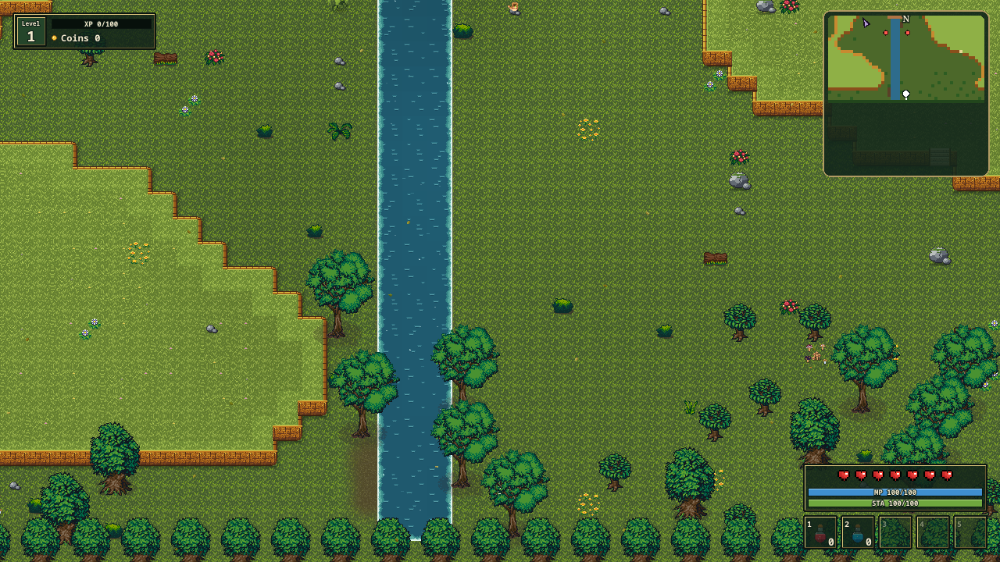

# Forest RPG V2


A pixel-art action RPG for the browser, built with TypeScript, PixiJS, and Vite. Explore a continuous procedural world of forests, meadows, highlands, wetlands and autumn woodland, battle enemies, and level up your character. Complete the starting area's coin and enemy objectives to unlock the portal to the next seeded world, or keep exploring farther into the forest.



## Features

- Persistent seeded landscapes that stream as you explore in any direction, with rivers, bridges, cliffs, and walkable hilltops.
- **Developer → Biomes** for peaceful exploration, five biome starting places and travel between them in the same world.
- A regional minimap that remembers explored terrain and saves that preserve collected treasure and changes to the forest.
- Day and night, changing weather, and ghosts after dark.
- Melee combos, spin attacks, magic bolts, and enemies with distinct behaviors.
- Character upgrades, health and speed potions, and progression between worlds.
- A training glade, remappable controls, and local saves with file import and export.

## Play locally

Requires Node.js `^20.19.0`, `^22.12.0`, or `>=24.0.0`, npm 10 or later, and a browser with WebGL support.

```sh
git clone https://github.com/golba98/Forest-RPG-v2.git
cd Forest-RPG-v2
npm ci
npm run dev
```

Open [localhost:3000](http://localhost:3000) to play. Choose **Play** to create or resume a named adventure across all five biomes. The temporary **Developer · Demo** section offers biome exploration and content previews with separate exploration saves.

## Controls

| Action                | Control                |
| --------------------- | ---------------------- |
| Move                  | WASD or arrow keys     |
| Sprint / dash         | Shift                  |
| Jump                  | Space                  |
| Melee attack          | E or left mouse button |
| Spin attack           | Q                      |
| Magic bolt            | R                      |
| Interact              | G                      |
| Health potion         | 1                      |
| Speed potion          | 2                      |
| Character progression | C or I                 |
| Cycle regional map    | M                      |
| Fullscreen            | F                      |
| Pause                 | Escape                 |

Gameplay controls can be remapped in settings. Save from the pause menu and choose your world under **Play** to resume. Rename, delete, import and export worlds from the world list. Progress is stored in your browser; export a save to keep a separate copy or move it to another browser.

For build commands, tests, and technical guides, see the [development documentation](docs/development/README.md).

## Credits

Ghost-grove artwork uses [LPC Flowers / Plants / Fungi / Wood](https://opengameart.org/content/lpc-flowers-plants-fungi-wood) by bluecarrot16 and contributors under **CC BY-SA 3.0**. See the [complete credits and adaptation notice](public/assets/licenses/grove/NOTICE.txt) for source details and the changes made to those assets.

Forest vegetation includes LPC artwork under CC BY-SA 3.0. See the [full credits](public/assets/images/environment/lpc/README.md).

<!-- documentation-publication-policy:start -->

## Documentation contributions

Agent instruction entrypoints (`AGENTS.md`, `CLAUDE.md`, `GEMINI.md`) are local-only and ignored by Git.

Keep temporary plans and agent notes in ignored `docs/tmp/`. Update existing guides for lasting user or contributor needs; ordinary tasks do not need a Markdown report.

After cloning, install local checks with `python3 scripts/check_documentation.py --install-hooks`. Run `python3 scripts/check_documentation.py` before publication. Public documentation and publication-policy changes require owner review of exact contents. Prepare a proposal with `python3 scripts/check_documentation.py --propose docs/tmp/documentation-review.json`; the owner reviews it in a separate terminal with `--review` and the same path. PR checks print the owner approval comment to post before rerunning validation. Hooks and CI cannot undo an initial public disclosure.
<!-- documentation-publication-policy:end -->
