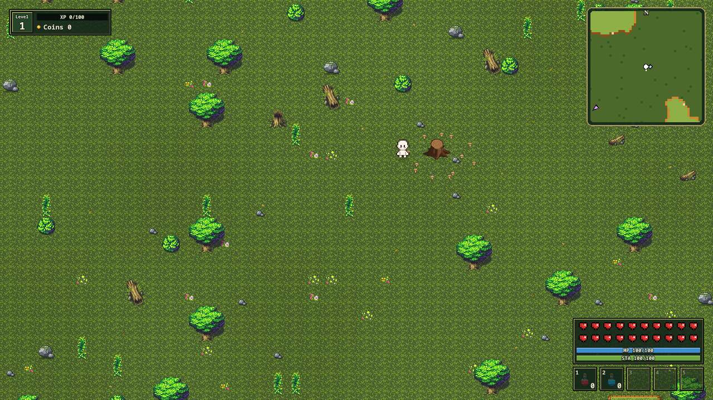

# Forest RPG V2


A pixel-art action RPG for the browser, built with TypeScript, PixiJS, and Vite. Explore procedurally generated forests, battle enemies, and level up your character. Collect coins and defeat each world's non-ghost enemies to unlock the portal to the next world.



## Features

- Seeded forests with rivers, bridges, cliffs, and walkable hilltops.
- Day and night, changing weather, and ghosts after dark.
- Melee combos, spin attacks, magic bolts, and enemies with distinct behaviors.
- Character upgrades, health and speed potions, and progression between worlds.
- A training glade, remappable controls, and local saves with file import and export.

## Play locally

Requires Node.js `^20.19.0`, `^22.12.0`, or `>=24.0.0`, npm 10 or later, and a browser with WebGL support.

```sh
git clone https://github.com/golba98/Forest-RPG-v2.git
cd Forest-RPG-v2
npm ci
npm run dev
```

Open [localhost:3000](http://localhost:3000) to play.

## Controls

| Action                | Control                |
| --------------------- | ---------------------- |
| Move                  | WASD or arrow keys     |
| Sprint / dash         | Shift                  |
| Jump                  | Space                  |
| Melee attack          | E or left mouse button |
| Spin attack           | Q                      |
| Magic bolt            | R                      |
| Interact              | G                      |
| Health potion         | 1                      |
| Speed potion          | 2                      |
| Character progression | C or I                 |
| Toggle minimap        | M                      |
| Fullscreen            | F                      |
| Pause                 | Escape                 |

Gameplay controls can be remapped in settings. Save from the pause menu and choose **Continue** from the main menu to resume. Progress is stored in your browser; export a save to keep a separate copy or move it to another browser.

For build commands, tests, and technical guides, see the [development documentation](docs/development/README.md).

## Credits

Ghost-grove artwork uses [LPC Flowers / Plants / Fungi / Wood](https://opengameart.org/content/lpc-flowers-plants-fungi-wood) by bluecarrot16 and contributors under **CC BY-SA 3.0**. See the [complete credits and adaptation notice](public/assets/licenses/grove/NOTICE.txt) for source details and the changes made to those assets.

Forest vegetation includes LPC artwork under CC BY-SA 3.0. See the [full credits](public/assets/images/environment/lpc/README.md).
