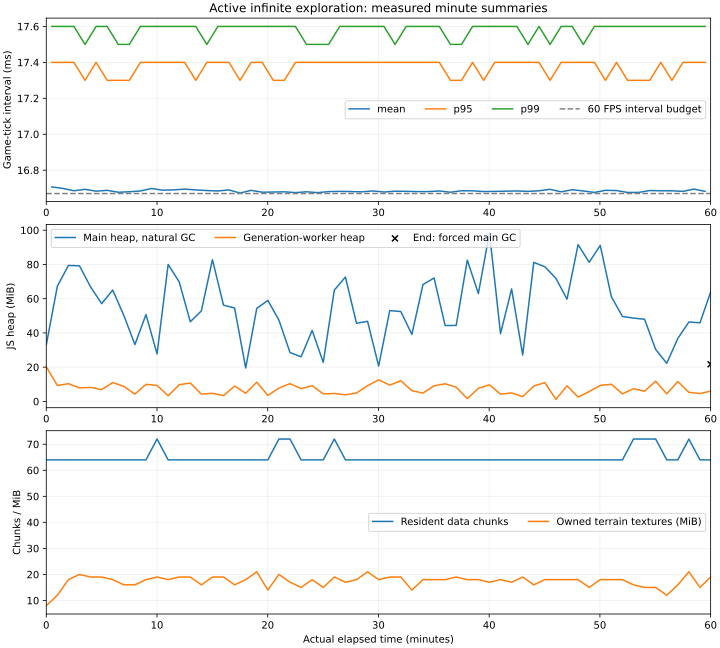

# Infinite-world performance investigation

Measured on November 1, 2026. This report concerns the local working tree on
`chore/infinite-world-profiling`, based on `a5cd38b6b78d05782346ea2a7d3ab7f0c3b381d1`.
The baseline already contained uncommitted infinite-world, rendering and artwork
changes. The investigation preserves those changes and does not optimize the game,
change generated terrain, replace artwork or migrate engines.

## A. Executive summary

**Status: investigation closed at the user’s request; remaining benchmarks were stopped.**
Completed results support continuing TypeScript/PixiJS, with transition work as
the clearest optimization target. Production readiness is **not certified**: frame
hitches, unresolved native-memory retention and incomplete cross-browser/resolution
verification remain.

The completed **60-minute active exploration** run averaged **59.94 FPS** at a
60 FPS cap on an Intel i7-13700 / RTX 4080. Its application frame intervals had a
16.70 ms median, 17.40 ms p95, 17.60 ms p99 and 46.80 ms maximum. There were 99
intervals above 33.33 ms in 215,774 frames. This establishes sustained gameplay on
this machine with occasional missed presentation intervals; it does not establish
perfect frame pacing or performance on ordinary desktop hardware.

The player travelled 21,661.91 tiles through active simulation using ordinary
keyboard controls. The run made 400 local-window transitions, generated 5,343
chunks including bootstrap, evicted 5,279, and ended with 64 baseline chunks.
There were no urgent terrain-preparation misses, browser errors, telemetry drops
or observable main-thread long tasks of at least 50 ms during the measured hour.
Only this stress scenario prevented death; its enemies, weather, collisions and
world simulation remained active.

The worker is not the same thing as the main-thread transition cost. Across 5,279
measured warm jobs, execution averaged 9.39 ms (p95 19.40 ms), with a separate
74.90 ms mean queue wait. Whole-window request to first safely renderable frame
averaged 168.83 ms (p95 269.40 ms); preparation ahead of the camera hid this
asynchronous latency. Reconstructing and installing the local window still
contains synchronous main-thread work.

## B. Benchmark environment

| Condition                 | Recorded value                                                                     |
| ------------------------- | ---------------------------------------------------------------------------------- |
| CPU                       | Intel Core i7-13700, 24 logical processors                                         |
| RAM                       | 32 GiB installed                                                                   |
| GPU                       | NVIDIA GeForce RTX 4080, 16 GiB nominal; driver 615.78.08                          |
| OS                        | Fedora Linux 44; kernel 7.2.13-200.fc44.x86_64                                     |
| Node                      | 22.23.1                                                                            |
| Installed libraries/tools | PixiJS 8.22.0; TypeScript 5.9.3; Vite 7.3.7; Playwright 1.64.1; Vitest 4.1.12      |
| Chromium                  | 156.0.8078.4, headful, ANGLE/OpenGL; hardware renderer verified inside the game    |
| Primary display           | Physical 2560×1440 at 239.998 Hz; desktop scale 4/3                                |
| Other displays            | 1920×1080 at 119.879 Hz and 1920×1080 at 143.600 Hz                                |
| Build                     | Vite production bundle with optional profiling compiled in; no development server  |
| Generation                | 32×32 data chunks; generator 13; forest biome version 1                            |
| Default comparisons       | Seed 42, CSS 1920×1080, DPR 1, zoom 2; frame cap and weather recorded per scenario |
| Stress                    | Same viewport/zoom, 60 FPS cap, natural weather, one wall-clock hour               |

The benchmark window was pinned wholly to the primary display. CSS viewport and
framebuffer size are recorded separately. Large emulated CSS viewports can exceed
the physical window: those tests measure rendering workload, not complete
physical scanout. The shipped 1440p tests instead use CSS 1920×1080, DPR 4/3 and
fullscreen, producing an actual 2560×1440 framebuffer with automatic camera zoom.
The same-footprint resolution controls keep CSS viewport and zoom fixed while
changing DPR; increasing CSS viewport also increases visible world area and is
reported as a separate experiment.

This is a shared workstation. Other applications were present; they were not
terminated. Repetitions and per-run output expose variability, but this is not an
isolated hardware laboratory. No lower-end, integrated-GPU, mobile, thermal or
battery-power measurements were made.

The CPU governor read `performance` with `intel_pstate` at the recorded hardware
checkpoint; CPU affinity, driver clocks and other applications were not changed.
GNOME Mutter's physical-mode state is retained in
`artifacts/performance/hardware/display-state.txt`; `xrandr`'s scaled virtual
dimensions alone would misidentify the actual displays.

### Provenance and controls

The inherited uninstrumented production build is retained at
`artifacts/performance/baseline/build`, with build fingerprint
`6c18a864fb66f905e7f495191a7a0183bacde447b3f6252f3d6b4309a1437a97`.
The final measured profiling build fingerprint is
`09bfce05fe4caf259160a280fddfe478997f70503a653fa563569bb9c6bde27e`.
Source/asset SHA-256 manifests, the inherited patch and build IDs are retained
under `artifacts/performance/`. A commit ID alone cannot identify this dirty tree.

The collector uses bounded browser rings and binary telemetry sent once per
second to a loopback receiver. Normal builds compile it out; a profiling build
also requires `profile=1` to install it. Detailed CPU/allocation traces, forced GC,
heap snapshots and video runs are separate from headline cadence measurements.
See the [collector and reproduction guide](README.md) for commands and definitions.

## C. Frame-time measurements

Frame interval means elapsed time between starts of rendered game ticks. It
includes browser scheduling and the game's limiter. It is an application cadence
measurement, not physical presentation or input-to-photon latency. Tick scope
means elapsed execution inside `GameLoop.tick`; asynchronous window installation
outside that call is measured separately. Neither scope equals OS thread CPU time.

Percentiles use nearest rank over raw intervals. **1% low FPS** is
`1000 / mean(slowest ceil(N × 0.01) intervals)`. It is not the inverse of p99.
The strict 16.67 ms threshold falls inside normal 60 Hz quantization/jitter; its
count must be read alongside p95/p99 and the count above 33.33 ms.

The completed campaign contains **22 runs / 106.014 measured minutes**, including
the active hour. The table uses raw samples, with no averaging of percentiles.
Each listed scene has **one completed pass**; the planned repeated scene matrix
was stopped before its later repetitions. These are descriptive observations,
not confidence intervals or a completed run-to-run variability study. All table
cases are uncapped at zoom 2 and DPR 1 except D (cap 60). Setup and warmup are
excluded. Seeds are 42 unless the name says otherwise.

| Scenario            | Repeats | Seconds | Frames |    FPS | Mean ms | Median ms | p95 ms | p99 ms | Worst ms | 1% low FPS | >16.67 ms | >33.33 ms |
| ------------------- | ------: | ------: | -----: | -----: | ------: | --------: | -----: | -----: | -------: | ---------: | --------: | --------: |
| A-idle              |       1 |   120.0 |  28793 | 239.87 |    4.17 |      4.20 |   4.70 |   5.10 |    13.10 |     148.49 |         0 |         0 |
| A-seed-123          |       1 |   120.0 |  28783 | 239.79 |    4.17 |      4.20 |   4.40 |   5.10 |    14.40 |     149.06 |         0 |         0 |
| A-seed-1337         |       1 |   120.0 |  28789 | 239.85 |    4.17 |      4.20 |   4.60 |   5.10 |    14.80 |     155.01 |         0 |         0 |
| B-explore           |       1 |   300.0 |  71744 | 239.12 |    4.18 |      4.20 |   4.90 |   5.20 |    32.80 |     122.46 |        44 |         0 |
| B-explore-gpu       |       1 |   120.0 |  28660 | 238.76 |    4.19 |      4.20 |   4.80 |   5.20 |    35.70 |     113.61 |        19 |         2 |
| C-fast              |       1 |   180.0 |  42883 | 238.19 |    4.20 |      4.20 |   4.80 |   5.20 |    34.00 |     101.96 |        57 |         2 |
| D-stress            |       1 |  3600.0 | 215774 |  59.94 |   16.68 |     16.70 |  17.40 |  17.60 |    46.80 |      50.26 |    110280 |        99 |
| F-dense             |       1 |   120.0 |  28792 | 239.87 |    4.17 |      4.20 |   4.60 |   5.20 |    13.90 |     150.60 |         0 |         0 |
| F-dense-seed-123    |       1 |   120.0 |  28795 | 239.90 |    4.17 |      4.20 |   4.40 |   5.20 |    14.40 |     152.61 |         0 |         0 |
| F-dense-seed-1337   |       1 |   120.0 |  28740 | 239.43 |    4.18 |      4.20 |   4.70 |   5.20 |    14.70 |     139.18 |         0 |         0 |
| G-bridge            |       1 |   120.0 |  28775 | 239.72 |    4.17 |      4.20 |   4.70 |   5.10 |    34.60 |     144.33 |         1 |         1 |
| G-bridge-seed-123   |       1 |   120.0 |  28775 | 239.72 |    4.17 |      4.20 |   4.60 |   5.10 |    35.80 |     144.01 |         1 |         1 |
| G-hill              |       1 |   120.0 |  28791 | 239.85 |    4.17 |      4.20 |   4.60 |   5.20 |    15.40 |     149.70 |         0 |         0 |
| H-combat            |       1 |   120.0 |  28794 | 239.87 |    4.17 |      4.20 |   4.50 |   5.10 |    14.30 |     148.47 |         0 |         0 |
| H-combat-waves      |       1 |   120.0 |  28788 | 239.82 |    4.17 |      4.20 |   4.70 |   5.20 |    14.70 |     146.50 |         0 |         0 |
| I-clear             |       1 |   120.0 |  28792 | 239.87 |    4.17 |      4.20 |   4.80 |   5.20 |    15.20 |     150.85 |         0 |         0 |
| I-clear-no-gpu      |       1 |   120.0 |  28793 | 239.87 |    4.17 |      4.20 |   4.70 |   5.10 |    14.20 |     156.89 |         0 |         0 |
| I-rain              |       1 |   120.0 |  28776 | 239.74 |    4.17 |      4.20 |   4.90 |   5.10 |    12.00 |     149.11 |         0 |         0 |
| I-rain-no-clouds    |       1 |   120.0 |  28788 | 239.84 |    4.17 |      4.20 |   4.60 |   5.10 |    13.00 |     149.78 |         0 |         0 |
| I-rain-no-particles |       1 |   120.0 |  28791 | 239.86 |    4.17 |      4.20 |   4.90 |   5.20 |    13.60 |     145.60 |         0 |         0 |
| K-northwest         |       1 |   120.0 |  28610 | 238.35 |    4.20 |      4.20 |   4.80 |   5.20 |    36.30 |     107.13 |        32 |         4 |
| K-southeast         |       1 |   120.0 |  28777 | 239.75 |    4.17 |      4.20 |   4.50 |   5.20 |    41.20 |     146.52 |         1 |         1 |

The stress tick scope averaged 1.28 ms, with p95 2.30 ms, p99 3.20 ms and a
maximum of 18.20 ms. This excludes asynchronous integration callbacks; it cannot
be used to claim that every main-thread task is below 16.67 ms. Raw rAF cadence
averaged 239.51 callbacks/s on the primary display while the game presented at 60.

Chromium's separate cumulative `ThreadTime` counter increased by the equivalent
of **10.77% of one CPU core** over the hour; renderer-process `ProcessTime` was
19.57% of one core. The latter includes other renderer-process threads. These
percentages are not whole-machine utilization on a 24-thread CPU and are not GPU
utilization. `TaskDuration` and `ScriptDuration` were collected in their default
elapsed-time domain and are kept distinct from thread/process CPU counters.
Chromium's implementation obtains `ThreadTime` from thread ticks and `ProcessTime`
from cumulative process CPU usage; see the
[metric implementation](https://github.com/chromium/chromium/blob/main/third_party/blink/renderer/core/inspector/inspector_performance_agent.cc)
and [protocol time domains](https://chromedevtools.github.io/devtools-protocol/tot/Performance/).

### Actual 1440p: short probes only

Two **10-second smoke probes**, CSS 1920×1080 / DPR 4/3 / fullscreen / automatic
zoom 2.25, verified a 2560×1440 framebuffer. They are not substitutes for the
unfinished repeated 1440p exploration and resolution-scaling matrix.

| Probe                | Frames |   FPS | Mean / median ms |  p95 / p99 ms | Worst ms | 1% low FPS | >16.67 / >33.33 ms | Tick mean / p95 ms | GPU mean / p95 ms |
| -------------------- | -----: | ----: | ---------------: | ------------: | -------: | ---------: | -----------------: | -----------------: | ----------------: |
| Dense forest, cap 60 |    601 | 60.00 |    16.67 / 16.60 | 17.40 / 17.60 |    19.60 |      55.87 |            268 / 0 |       0.603 / 0.90 |     0.365 / 0.412 |
| Rain/bridge, cap 60  |    601 | 60.02 |    16.66 / 16.60 | 17.40 / 17.50 |    17.60 |      56.91 |            283 / 0 |       1.630 / 2.10 |     0.383 / 0.407 |

Only 21 GPU samples were returned per probe. The camera footprint differs from
the zoom-2 comparisons; no pixel-only scaling conclusion is drawn. Long-distance
1440p gameplay, 720p/1080p/1440p same-footprint sweeps and 120 FPS cap verification
remain unmeasured in this investigation.

### Instrumentation calibration

Three rotated repetitions compared the inherited production bundle, profiling
build with adapter disabled, and profiling enabled over 60-second idle/moving
fixtures (18 runs). In the first matched moving repetition, renderer elapsed
scope was 0.425 / 0.464 / 0.599 ms and CDP script elapsed time per frame was
0.519 / 0.565 / 0.734 ms respectively. Instrumentation has measurable cost.
Other repetitions varied substantially, including lower cadence in disabled
builds, so a universal overhead percentage is not supported. No correction is
subtracted from the reported timings.

One enabled calibration run had an unexplained 9.85-second frame and a 9.44-second
long task, with 8.70 seconds elapsed inside encoding a roughly 166 KB packet.
Elapsed scope does not prove encoding computation consumed that CPU time. The
outlier remains in calibration evidence; it is not attributed to world generation.
It did not recur in the completed hour, whose encoder averaged 0.102 ms and
peaked at 2.10 ms. This limits claims about the profiler's worst-case overhead.
The clear-scene GPU-query-off control measured 0.875 ms mean tick versus 0.962 ms
with queries, a single-pass comparison rather than a calibrated causal estimate.

## D. Memory analysis

Natural main-heap samples during active exploration ranged from 19.52 to
98.52 MiB. After the hour, explicit GC left 21.7 MiB in the main JS heap and
3.4 MiB in the generation worker. Natural samples include garbage awaiting GC;
the rise and fall alone do not prove a leak. Process PSS/RSS, worker heap and
owned resources are recorded separately.

Across the CDP-listed browser processes, sampled PSS ranged from 808.25 to
1,100.52 MiB and RSS from 1,457.00 to 1,758.11 MiB. End-of-hour forced GC reduced
PSS to 931.18 MiB and RSS to 1,589.25 MiB. These include Chromium, GPU, networking,
storage, audio and renderer processes; RSS sums also double-count shared pages.
They must not be presented as a 22 MiB total application footprint merely because
the main JS heap is small.

The final active-window cache held 64 chunks and 65,536 bytes of baseline tile
buffers. This excludes prop objects, worker generator caches, persistent deltas
and presentation copies. Persistent explored-region history resides in IndexedDB
and is expected to grow with exploration; bounded RAM does not mean bounded disk.

### Controlled eviction and restoration

The laboratory froze simulation and repeatedly teleported home → region B →
region C → home, waiting six seconds at each stop so the five-second retention
period expired. This is an eviction experiment, not a gameplay-speed result.
Twenty cycles generated 3,960 chunks in total, evicted 3,896 and ended with 64.
All home fingerprints matched; the removed flower remained absent and the opened
chest remained opened. Its five-coin reward stayed five after ten warm save/load
cycles and five page-reload restorations.

After the first three warming cycles, forced-GC main heap ranged from 15.11 to
15.59 MiB, ending at 15.56 MiB. The worker ended at 2.81 MiB. Same-region terrain
residency stayed at eight textures / 8 MiB, with 72 owned subtextures. The two
selected heap snapshots contained two world-shaped objects in each, and 228 → 230
Sprite-shaped objects; detached flags stayed 350 → 350. These are counts/self-size
observations, not dominator analysis or proof that every retained object is needed.
Cloud/effect state can change even while gameplay simulation is frozen.

No accumulating obsolete-world or owned-texture retention was demonstrated by
these cycles. Process PSS nevertheless increased from 646.45 to 690.82 MiB between
selected checkpoints; most of that increase was in the game renderer process,
while GPU-process PSS decreased slightly. The first heap snapshot occurred between
those checkpoints and can itself allocate native memory. PSS still rose about
17.6 MiB after the first post-snapshot checkpoint. This is **unclassified native
retention**, not a confirmed leak or a demonstrated plateau. The follow-up tool omits
heap snapshots and repeated hashes, adds idle recovery periods, and includes the
uninstrumented production build, but **was not executed before closeout**. Stable JS heap alone cannot certify bounded
total process memory. Multi-hour/day runs and lower-memory devices remain
necessary before setting a production memory budget.

There is no precise total GPU-memory measurement. Owned terrain targets have
explicit byte accounting. Other texture estimates use base RGBA8 dimensions for
referenced/TextureStore-owned sources and exclude driver storage, mipmaps, filters,
some global assets and decoded images. The browser did not expose
`measureUserAgentSpecificMemory`; the page was not cross-origin isolated.
See [MDN's API requirements](https://developer.mozilla.org/en-US/docs/Web/API/Performance/measureUserAgentSpecificMemory)
and [WebGL memory guidance](https://developer.mozilla.org/en-US/docs/Web/API/WebGL_API/WebGL_best_practices).

## E. Chunk performance

The documented architecture matches the implementation: 32×32 deterministic data
chunks, a typical 192×192 local simulation window, 16×16 terrain render textures,
one serial generation worker, separate preparation/retention regions, bounded
baseline/field/render caches and camera-relative rebasing. Tile/chunk addressing
uses floor division across negative coordinates. The supported tile-coordinate
limit is ±2,147,483,647, not mathematical infinity.

The worker synthesizes baseline terrain and props. IndexedDB region establishment,
delta hydration, local-window construction, actor rebasing, moisture-site/index
rebuilding, terrain texture preparation and GPU submission involve the main
thread. Large asynchronous readiness values must not be called frame stalls.

| Measured phase, active hour                                           | Samples | Mean ms | p95 ms | p99 ms | Worst ms |
| --------------------------------------------------------------------- | ------: | ------: | -----: | -----: | -------: |
| Warm worker execution                                                 |   5,279 |    9.39 |  19.40 |  28.80 |    44.20 |
| Serial queue wait                                                     |   5,279 |   74.90 | 176.30 | 226.80 |   293.60 |
| Request to baseline ready                                             |   5,279 |   84.87 | 186.30 | 238.40 |   306.50 |
| Combined worker round-trip overhead, excluding execution/construction |   5,279 |    0.24 |   1.20 |   2.20 |     4.50 |
| Window request to first safe frame                                    |     400 |  168.83 | 269.40 | 322.50 |   344.30 |
| Local-window baseline assembly                                        |     400 |    7.44 |   9.70 |  12.50 |    14.00 |
| Surface-site index construction                                       |     400 |    7.14 |  11.20 |  13.90 |    15.60 |
| Moisture restoration                                                  |     400 |    4.84 |   6.60 |   7.40 |     9.00 |
| Simulation window install, inclusive                                  |     400 |   12.67 |  17.20 |  19.80 |    23.40 |

The index and moisture timings are nested inside installation; do not add their
inclusive totals to the install total. Worker transfer phases have timer-resolution
and cross-context clock uncertainty. Combined round-trip overhead is more robust
than sub-millisecond one-way differences; it includes scheduling as well as transfer.

The measured hour had 20,321 cache-hit events, 3,933 distinct generated addresses,
1,346 regenerations, a peak observed queue of 22 and peak resident count at job
dispatch of 87. Final residency was 64. These sampled peaks are labelled by their
observation point rather than represented as continuous memory maxima.

All 99 intervals above 33.33 ms overlap baseline assembly and simulation-window
installation in the preceding frame interval. Their previous tick scopes are
also retained, so this association does not incorrectly attribute a delayed
callback to work that happens after that callback starts. This is direct evidence
for prioritizing synchronous integration. It does not prove that browser
scheduling contributes nothing to those intervals.

### Architecture audit and execution placement

| System               | Source and behavior                                                                                                                         | Execution / cost boundary                                                                                                                                             |
| -------------------- | ------------------------------------------------------------------------------------------------------------------------------------------- | --------------------------------------------------------------------------------------------------------------------------------------------------------------------- |
| Loop and input       | `src/core/loop/GameLoop.ts`: 60 Hz fixed simulation accumulator, rAF rendering and optional frame limiter; `IntentMapper` intent collection | Main thread; input, fixed updates and presentation timed separately                                                                                                   |
| Generation           | `src/world/infinite/ForestGenerator.ts`, `generation.worker.ts`: seed/version/address-derived forest, bridges, hills and scenery            | Serial worker; bounded field cache; cooperative fallback if workers unavailable                                                                                       |
| Streaming            | `ChunkSource.prepare/evict`, `InfiniteSession.prepareAt/buildWindow/prune`, `Simulation.advanceStream/installStream`                        | Worker preparation plus main-thread repository work, assembly, hydration and rebasing; 5-second retention and 128-chunk cache pressure threshold                      |
| Camera and terrain   | `Camera.ts`, `WorldVisibility.ts`, `TerrainChunks.ts`                                                                                       | Camera-relative local coordinates; separate visible/preparation/retention rectangles; 2 ms ordinary preparation target, synchronous initial/discontinuous preparation |
| Props and collisions | `WorldObjects.ts`, `WorldBoundsIndex`, `CollisionSystem.ts`                                                                                 | Main-thread spatial buckets and lazy per-world collider indexes; source discovery and view residency are separate                                                     |
| Enemies              | `EnemyAISystem.step/navigate/separate`, `pathfinding.ts`                                                                                    | Fixed simulation on main thread; navigation/pathfinding and sampled collision queries instrumented                                                                    |
| Animation/depth      | `EntityAnimator.resolve`, `WorldDepthLayer.sortChildren`, `PixiRenderer.renderEntities`                                                     | Main-thread presentation; actual sorting measured when invoked                                                                                                        |
| Water/weather        | `WaterLayer`, `SurfaceWaterLayer`, `WeatherLayer`, `SkyLayer`, `AmbientLayer`, `SurfaceMoisture`                                            | Main-thread simulation/dynamic Graphics preparation, then Pixi submission/GPU blending                                                                                |
| Textures/batching    | `TextureStore.ts`, `TerrainChunks.startJob/finishJob`, Pixi GL adaptor                                                                      | CPU sprite/soil construction, offscreen render targets, GL uploads and actual draw calls; shared textures retained separately                                         |
| Persistence          | `SaveManager.ts`, `WorldRepository.ts`, `InfiniteSession.checkpoint`                                                                        | Versioned IndexedDB deltas, immutable slot references and background history compaction; API wall time differs from synchronous blocking                              |
| Minimap              | `Minimap.ts`                                                                                                                                | Local window/radar update and rebuild; no world-sized bitmap                                                                                                          |

The 192-tile window can grow up to 512 tiles for large views; its assembly/index
cost is therefore sensitive to camera scale and viewport. The coordinate guard
also reserves 1,024 tiles inside the numeric limit for preparation. Future biome
registration and region identity are already versioned; this investigation did
not register new biomes or alter existing selection.

## F. Rendering analysis

Actual WebGL draw/bind/upload calls are counted, including offscreen terrain
bakes. Submitted sprites and batch elements are sampled from Pixi's GL batch
adaptor; scene Sprite counts include prepared objects and differ from submission.
GPU command-span elapsed time is sampled asynchronously every 30 rendered frames,
with at most 16 pending queries and disjoint results discarded. It is not GPU
utilization or full browser composition time. The
[WebGL timer-query specification](https://registry.khronos.org/webgl/extensions/EXT_disjoint_timer_query_webgl2/)
describes these constraints.

### Measured submission and execution

| Scenario            | Tick mean / p95 ms | GL draws/frame | Terrain draws/frame | Texture binds/frame | Submitted sprites/sample | Batches/sample | GPU mean / p95 ms | Long tasks |
| ------------------- | -----------------: | -------------: | ------------------: | ------------------: | -----------------------: | -------------: | ----------------: | ---------: |
| A-idle              |       0.488 / 0.70 |          48.00 |               0.000 |               82.00 |                    199.7 |           46.0 |     0.155 / 0.179 |          0 |
| A-seed-123          |       0.851 / 1.20 |          47.00 |               0.000 |               65.00 |                        — |              — |             — / — |          0 |
| A-seed-1337         |       0.544 / 0.80 |          40.00 |               0.000 |               61.00 |                        — |              — |             — / — |          0 |
| B-explore           |       0.956 / 1.70 |          51.72 |               0.005 |               75.70 |                        — |              — |             — / — |          0 |
| B-explore-gpu       |       0.743 / 1.30 |          50.71 |               0.005 |               77.87 |                    226.0 |           47.8 |     0.153 / 0.172 |          0 |
| C-fast              |       0.815 / 1.40 |          51.65 |               0.011 |               76.14 |                        — |              — |             — / — |          0 |
| D-stress            |       1.278 / 2.30 |          51.61 |               0.021 |               73.08 |                        — |              — |             — / — |          0 |
| F-dense             |       0.446 / 0.70 |          45.00 |               0.000 |               69.00 |                    188.1 |           43.0 |     0.159 / 0.180 |          0 |
| F-dense-seed-123    |       0.436 / 0.70 |          44.00 |               0.000 |               75.00 |                        — |              — |             — / — |          0 |
| F-dense-seed-1337   |       0.430 / 0.70 |          41.00 |               0.000 |               63.00 |                        — |              — |             — / — |          0 |
| G-bridge            |       0.985 / 1.40 |          49.04 |               0.002 |               84.38 |                    218.4 |           46.0 |     0.161 / 0.179 |          0 |
| G-bridge-seed-123   |       0.805 / 1.20 |          55.63 |               0.002 |               92.55 |                        — |              — |             — / — |          0 |
| G-hill              |       0.467 / 0.70 |          44.00 |               0.000 |               68.00 |                    177.2 |           42.0 |     0.169 / 0.190 |          0 |
| H-combat            |       0.564 / 0.90 |          46.57 |               0.000 |               78.79 |                    226.8 |           44.0 |     0.189 / 0.243 |          0 |
| H-combat-waves      |       0.693 / 1.10 |          60.97 |               0.000 |               99.17 |                    247.0 |           53.0 |     0.286 / 0.322 |          0 |
| I-clear             |       0.962 / 1.40 |          52.00 |               0.000 |               98.00 |                    248.1 |           50.0 |     0.159 / 0.179 |          0 |
| I-clear-no-gpu      |       0.875 / 1.20 |          52.00 |               0.000 |               98.00 |                        — |              — |             — / — |          0 |
| I-rain              |       1.350 / 1.80 |          56.00 |               0.000 |               99.38 |                    248.1 |           51.0 |     0.186 / 0.206 |          0 |
| I-rain-no-clouds    |       1.311 / 1.70 |          48.00 |               0.000 |               87.38 |                    204.0 |           43.0 |     0.129 / 0.128 |          0 |
| I-rain-no-particles |       0.997 / 1.50 |          53.00 |               0.000 |               97.00 |                    222.1 |           50.0 |     0.159 / 0.178 |          0 |
| K-northwest         |       0.613 / 1.00 |          44.16 |               0.002 |               70.83 |                        — |              — |             — / — |          0 |
| K-southeast         |       0.569 / 0.90 |          58.13 |               0.002 |               81.97 |                        — |              — |             — / — |          0 |

D deliberately did not enable GPU queries. Its 51.61 draws/frame are actual GL
calls; its submitted-sprite count is unavailable. D's scene census ranged from
162 to 436 Sprite objects, which must not be substituted for submitted sprites.
The final partial texture-source estimate was 27.95 MiB; sampled owned terrain
color targets ranged from 8 to 21 MiB, below the 64 MiB ordinary target.

In the matched bridge scene, rain increased mean tick scope from 0.962 to
1.350 ms, actual draws from 52 to 56 and GPU span from 0.159 to 0.186 ms. Weather
update mean rose from 0.006 to 0.223 ms and Pixi submission/preparation from 0.485
to 0.694 ms. Sampled rain populations were 141–152 drops and 76–82 impacts.
Hiding clouds reduced GPU span to 0.129 ms and draws to 48, while CPU was
1.311 ms. `SkyLayer.update` continues simulation when clouds are hidden; its
reported cloud count is retained population, not visible-cloud count.
The particles-off control measured 0.997 ms CPU / 0.159 ms GPU, but that switch
also removes overcast tint and ambient particles, so it is not a pure raindrop
ablation. Wetness simulation remains enabled.

Combat's initial six injected enemies were defeated early (live population
22 → 16). The maintained-wave test replenished nearby enemies every five seconds
and sampled 22–23 live enemies overall. Tick mean rose 0.564 → 0.693 ms; GPU
span 0.189 → 0.286 ms and draws 46.57 → 60.97. AI mean per rendered frame was
0.0105 → 0.0218 ms; pathfinding about 0.0001 ms, and depth sorting
0.0069 → 0.0109 ms. These are diluted per-render-frame means with 60 Hz fixed
simulation, not per-pathfinding-call timings. Potions, damage and cooldowns worked
normally; no ordinary combat death prevention was enabled.

Bridge movement averaged 0.985 ms tick / 0.161 ms GPU; the stationary hilltop-rock
scene 0.467 / 0.169 ms. Scene composition differs, so subtracting these values
would not isolate the cost of one bridge or rock. No current AI/pathfinding/depth
sorting ceiling was demonstrated. Pixel-fill and overdraw costs were not isolated
with a graphics capture/heatmap; sampled GPU spans on this RTX 4080 are well below
the desktop frame budget. Global Assets-cache residency and native allocations
remain outside the partial texture census; the extra census tool was not run.

## G. Top performance bottlenecks

### Synchronous window reconstruction and installation

The active hour ties all 99 intervals above 33.33 ms to transition work. For a
concrete example, the interval ending at page time 16,868 ms lasted 43.4 ms.
`InfiniteSession.buildWindow` occupied 14.0 ms beginning at 16,827.5 ms;
`Simulation.installStream` then occupied 23.4 ms, including 12.5 ms building
`SurfaceSites` and 9.0 ms restoring moisture. These events fall **between tick
starts**, explaining why the preceding tick scope was only 0.9 ms.

Responsible code: `Simulation.advanceStream/installStream` in
[`src/simulation/Simulation.ts`](../../src/simulation/Simulation.ts),
`InfiniteSession.buildWindow/restoreMoisture` in
[`InfiniteSession.ts`](../../src/world/infinite/InfiniteSession.ts), and
`SurfaceSites.constructor` in
[`SurfaceMoisture.ts`](../../src/systems/SurfaceMoisture.ts).
Reproduce by following the recorded keyboard route at seed 42, cap 60, zoom 2;
join `summary.json` slow-frame intervals with their overlapping phase events.
This is an algorithmic/implementation issue: whole-window assembly and derived
state reconstruction are synchronous even though baseline generation uses a
worker. It is not evidence of a TypeScript language ceiling.

No ≥50 ms long task occurred in the completed hour. A sequence of synchronous
work below that threshold can still miss a 16.67 ms frame budget; “zero long
tasks” therefore does not mean “zero stalls.”

The world-readiness/install guard also skipped **186 fixed-update opportunities**
in the measured hour, across 166 rendered frames (maximum two skips in one
frame). At the 60 Hz fixed step this represents 3.10 seconds of nominal simulation
time spread through the hour, not 3.10 seconds of continuous CPU blocking.
`Game.fixedUpdate` returns while `Simulation.isWaitingForWorld` is true; this
includes installation and an unprepared-edge safety condition. The counter does
not separately label those two reasons. Thus “no urgent terrain misses” must not
be read as “world transitions never withhold a movement step.”

### Ranked findings and profiler evidence

| Rank | Finding                                          | Measured impact / evidence                                                                                                                                                     | Classification                                                                   |
| ---- | ------------------------------------------------ | ------------------------------------------------------------------------------------------------------------------------------------------------------------------------------ | -------------------------------------------------------------------------------- |
| 1    | Whole-window reconstruction and installation     | All 99 >33.33 ms hour intervals overlap 99 distinct installs; example and source paths above. 186 fixed updates were withheld.                                                 | Algorithmic / implementation-specific main-thread scheduling                     |
| 2    | Dynamic Graphics preparation and Pixi submission | D mean submission scope 0.700 ms, about 55% of its measured tick elapsed scope. Rain adds weather construction and submission cost despite almost unchanged FPS.               | Renderer usage / allocation opportunity, not an established language limit       |
| 3    | Unclassified native process retention            | Stable JS/resources but renderer PSS rises in the controlled cycle experiment; heap-snapshot confound prevents a leak diagnosis.                                               | Browser/driver/allocator/application attribution unresolved; follow-up required  |
| 4    | Save-time synchronous work in the laboratory     | Ten manual saves took 4.8–56.0 ms API wall time; across 25 observed save entries the synchronous prefix peaked at 51.5 ms. Ordinary active-save frame impact was not isolated. | Persistence implementation candidate; not a demonstrated everyday gameplay stall |

The real 30-second post-hour CPU profile maps attributed stacks to Pixi
`GraphicsContext.fill`, `buildContextBatches`, `GraphicsContextSystem.updateGpuContext`,
Earcut tessellation, `EnemyAISystem.separate`, `SurfaceMoisture.step` and
`Simulation.buildRenderSnapshot`. The raw profile contains 13.07 seconds of
unresolved `(program)` sampled wall intervals out of 30.12 seconds; **those are
not assigned to CPU execution or native engine overhead**. The known stacks
corroborate the coarse scopes but do not support precise whole-CPU percentages.

The associated trace contains 134 main-thread MinorGC events (mean 1.489 ms,
p95 2.011 ms, worst 2.412 ms) and 12 MajorGC events (worst 3.229 ms). Worker GC
was separate: 620 minor events, worst 0.271 ms. These are selected heavy-trace
observations, not hour-wide GC statistics. Nested V8 finalize phases are not
added again. Allocation-volume sampling and main-only profiler controls were not
completed, so bytes allocated per second and the cause of unresolved samples
remain unknown.

Reproduce rendering costs with `I-clear` / `I-rain` and inspect `pixi.submit`,
`weather.update`, actual GL counters and GPU samples. Relevant application sources
are [`PixiRenderer.render`](../../src/rendering/PixiRenderer.ts),
[`WaterLayer.update`](../../src/rendering/effects/WaterLayer.ts),
[`WeatherLayer.update`](../../src/rendering/effects/WeatherLayer.ts) and
[`SurfaceWaterLayer.update`](../../src/rendering/effects/SurfaceWaterLayer.ts).
Memory reproduction is `lab.mjs`; clean follow-up is `retention.mjs` (not run).
Save reproduction and caveats are below. GPU saturation, excessive object sorting,
worker transfer overhead and TypeScript execution ceilings were **not** established
as significant bottlenecks by these runs.

## H. Optimization opportunities

No optimization or engine migration is included in this investigation. Proposed
benefits require a measured before/after experiment on the same build conditions.

| Priority | Proposed experiment                                                                                                                                                                      | Expected benefit — hypothesis until tested                                                                                                                                                 | Complexity  | Regression risk / validation gate                                                                                                                                                              |
| -------- | ---------------------------------------------------------------------------------------------------------------------------------------------------------------------------------------- | ------------------------------------------------------------------------------------------------------------------------------------------------------------------------------------------ | ----------- | ---------------------------------------------------------------------------------------------------------------------------------------------------------------------------------------------- |
| P0       | Prepare immutable surface/collider metadata per data chunk, then reuse overlap when shifting the window. Apply edits incrementally rather than rescanning unchanged tiles/props.         | Reduce the measured 7.14 ms mean surface-index construction and some subsequent collider/index work per transition. No FPS gain is assumed.                                                | High        | High: bridges, hills, moisture eligibility and placed/removed objects must retain identical semantics; deterministic geography and collision/traversal tests are mandatory.                    |
| P0       | Reuse/shift local terrain and moisture buffers; stage assembly and derived state before an atomic installation. Limit main-thread integration slices independently of worker generation. | Reduce the measured baseline assembly and install bursts, and avoid withholding fixed updates during persistence waits.                                                                    | High        | High: actors, attacks, encounters, camera interpolation, moisture history and saves must remain coherent across the swap. Replay the same hour route and compare missed intervals/guard skips. |
| P1       | Profile and cache stable Graphics geometry; investigate persistent particle/mesh buffers for dynamic water and weather while preserving visual output.                                   | Reduce render preparation and allocation where CPU profiles corroborate those paths; allocation volume still needs measurement. This should be tested before introducing another language. | Medium–high | Medium–high: river flow, bridge layering, rain landing positions and pixel-art appearance need screenshot/video regression checks; compare CPU, GPU and allocation together.                   |
| P1       | Establish midrange/integrated-GPU budgets with the same CSS footprint and separate DPR sweeps.                                                                                           | Determine whether a quality/resolution setting is needed and whether the current RTX 4080 results generalize.                                                                              | Low–medium  | Low: a measurement task; do not change world output or hide effects to claim an optimization.                                                                                                  |
| P2       | Measure longer-lived IndexedDB histories, quota pressure, repeated slot forks and compaction on slower storage.                                                                          | Find persistence scaling limits beyond this hour and the short controlled save experiment.                                                                                                 | Medium      | Medium: immutable slots, crash recovery, old-world landmarks and rewards must survive. Asynchronous compaction wall time alone does not justify a rewrite.                                     |
| P2       | Investigate render ordering/atlas sharing only where real GL counters and CPU profiles show batching costs.                                                                              | Potentially reduce submission overhead on weaker drivers; current draw counts alone do not establish a GPU bottleneck.                                                                     | Medium      | Medium: preserve depth ordering and shared-texture ownership. Compare actual draws and GPU span, not an estimated draw-call count.                                                             |

Pixi's own guidance recommends batching compatible sprites and avoiding repeated
modification of complex Graphics; it also cautions that culling can add CPU cost.
These are candidate techniques, not measured improvements to this game.
[PixiJS performance guidance](https://pixijs.com/8.x/guides/concepts/performance-tips).

## I. Native migration assessment

No native engine or WASM prototype was benchmarked, so this investigation cannot
demonstrate a native FPS advantage or predict a numeric speedup.

**Recommendation: option 1 — keep TypeScript/PixiJS for the next development
milestone.** The measured transition problem has identifiable whole-window work;
moving that same work to another language would leave its scheduling and
reconstruction strategy in place. The completed hour and stable same-region
resource counts support continuing this architecture while fixing measured
integration and pacing issues. They do not certify the game as commercially ready.

The browser runs the production JavaScript/WebGL bundle. Type annotations are
erased during compilation; “written in TypeScript” does not identify a runtime
bottleneck. [TypeScript's explanation of erased types](https://www.typescriptlang.org/docs/handbook/2/basic-types.html#erased-types).

| Path                          | Evidence-based assessment                                                                                                                                                                                            | Cost and decision gate                                                                                                                                                                                                                         |
| ----------------------------- | -------------------------------------------------------------------------------------------------------------------------------------------------------------------------------------------------------------------- | ---------------------------------------------------------------------------------------------------------------------------------------------------------------------------------------------------------------------------------------------- |
| TypeScript/PixiJS             | Existing worker separation, local coordinates, bounded rendering and persistence already support sustained exploration. The transition code offers a concrete target within the current engine.                      | Lowest migration risk. Measure targeted integration/rendering improvements on the same routes, then verify a midrange and integrated-GPU device.                                                                                               |
| Rust + WASM inside the worker | Technically possible without replacing Pixi. Current worker execution is asynchronous and has not exhausted preparation throughput on this machine; accelerating it alone would not remove main-thread installation. | Prototype only after a CPU kernel is shown to constrain a target device. Include memory conversion, prop serialization, worker communication and compilation/startup; preserve deterministic output and save identity.                         |
| Rust + Bevy                   | An ECS and native rendering could be useful for much larger simulations or a native product requirement, but neither benefit was demonstrated here.                                                                  | Would rebuild the scene/UI/input/asset/persistence integration and port collision, encounters, terrain/depth behavior and compatibility tests. Bevy's own introduction describes an ECS/parallelism focus and warns about API migration costs. |
| Godot                         | Built-in 2D scenes, animation, physics, editor and export workflows could improve authoring if those become product requirements. They are not evidence of faster execution of this game's rules.                    | Recreate bridge/hill collision and depth semantics, world streaming, seed-compatible generation, save migration, DOM UI and controls. Judge tooling value with one representative playable slice before choosing a migration.                  |
| C++ / custom native renderer  | No browser or language ceiling was established that requires a custom engine. Native packaging and direct graphics access may serve future platform requirements.                                                    | Highest engineering ownership: renderer, tooling, asset pipeline, UI, input and platform integration. No measured FPS multiplier justifies that cost.                                                                                          |

The capability statements above come from the official
[WebAssembly JS/memory interface](https://webassembly.org/getting-started/js-api/),
[Bevy introduction and stability guidance](https://bevy.org/learn/quick-start/introduction/)
and [Godot feature documentation](https://docs.godotengine.org/en/stable/about/list_of_features.html).
The recommendation and project-specific migration costs are engineering inferences
from this source audit and the measurements, not claims those documents make
about Forest RPG.

If a later target-device result justifies WASM, compare the **same algorithm** in
the existing JS worker and a small Rust/WASM worker using identical seeds,
positive/negative addresses and cache states. Report kernel and end-to-end p95,
startup, allocation, serialization and main-thread readiness. Include generation
hash/save compatibility as a hard gate. An isolated kernel speedup without an
improved gameplay constraint is insufficient reason to expand the port. No such
prototype or port was performed in this milestone.

## J. Evidence, reproduction and validation

All timings are actual executions. Curated screenshots: [end of the active hour](../images/performance/exploration-hour.png) and [the actual 1440p rain probe](../images/performance/rain-1440.png). Raw evidence is local and ignored by Git:

| Evidence                                            | Location                                     |
| --------------------------------------------------- | -------------------------------------------- |
| Completed active hour                               | `artifacts/performance/campaign/D-stress-0/` |
| Raw telemetry and phase events                      | Each run's `telemetry.jsonl.gz`              |
| Environment, conditions and checkpoints             | Each run's `run.json` and `scenario.json`    |
| Original production build and dirty-tree provenance | `artifacts/performance/baseline/`            |
| Matched instrumentation calibration                 | `artifacts/performance/calibration/`         |
| Source/asset manifests and build fingerprints       | `artifacts/performance/manifests/`           |
| Typecheck, lint, tests and production build         | `artifacts/performance/validation/`          |

The active hour followed a precomputed collision-valid route using actual keyboard
events. Route fingerprint:
`17a4e750d3de865a85fd61612d57e7d93f1070620fbfe7cfaa9007ee08e49f93`.
It had one adaptive steering correction, zero blur events and zero telemetry
continuity gaps. No position teleportation or time scaling occurred during it.

Two interrupted stress attempts are retained and excluded from the hour's
statistics. The first stopped after a controller steering deadzone caused repeated
jumps against a bridge rail; the defect reproduced without enemies. The second
controller's waypoint timeout falsely rejected a long traversable segment while
the player was still approaching its target. Only the benchmark controller was
repaired: adaptive fine steering and a monotonic target-progress watchdog, with
three regression tests. Game movement, collision and generation were unchanged.
The original artifacts/builds remain under `stress-controller-failure/`,
`stress-watchdog-false-positive/`, `profile-v1/` and `profile-driver-v3/`.

Known instrumentation limits: stage/event percentiles use 0.1 ms histogram bins;
CPU/frame percentiles use raw samples. Collision timings sample calls rather than
timing every hot query. CPU profiles contain sampled wall intervals; unresolved
`(program)` samples are not attributed CPU work. Heap summaries count nodes and
self size, not dominator retained size. Browser process measurements include
browser infrastructure and are not solely game objects. GC pauses are assessed
only in selected traces. No precise GPU-memory, physical scanout, overdraw heatmap
or lower-end-hardware claim is made.

### Save/reload measurements

The controlled laboratory's ten manual saves averaged 34.09 ms API wall time
(median 46.85 ms, maximum 56.00 ms); ten warm loads averaged 794.95 ms
(median 800.35, maximum 821.00). Five page-reload restorations averaged 713.90 ms
for the load API (maximum 729.20), excluding document bootstrap. All restored the
edited fingerprint and five-coin reward. Slot fork itself averaged 0.24 ms wall
in the ten observed calls; most load time is elsewhere, including reconstructing
64 baseline chunks and derived state.

The original fresh-load collector started before autostart reached the playing
scene, so it self-stopped and returned **no first-safe-frame events**. Restoration
and API wall timings are valid, but first-frame readiness is not established by
those five runs. The helper was corrected and a supplemental reload tool prepared;
that follow-up was not run. The clean active-save, cold-start and blank-process
controls also were not run. Laboratory frame times include deliberate GC,
teleports and snapshots and are not headline gameplay cadence.

### Coverage and incomplete work

The campaign completed D plus 21 scene runs (106.014 minutes total), nine short
fixture smoke checks, 18 calibration runs, the 20-cycle persistence laboratory,
and selected post-hour CPU/worker/GC traces. The final seed-1337 bridge case was
interrupted with a paused page; following viewport setups encountered closed
browser contexts. Their partial/error artifacts are preserved and excluded from
complete-run tables. No game defect is assigned to that interruption without a
reproduction.

Remaining scene repetitions, the full resolution matrix, long 1440p exploration,
120 FPS cap/physical-refresh checks, Firefox profiling, fresh video capture,
allocation profiles, global asset census and the clean native-retention follow-up
were **not completed**. They are not silently marked passed. Available tools for
those follow-ups are documented in the [profiling guide](README.md). No new
recording is claimed; actual screenshots, traces, CPU profiles, heap snapshots
and raw benchmark telemetry are retained. Prior project recordings are not
presented as this investigation's evidence.

### Target evaluation

| Target                                                         | Result                                                                                                                 |
| -------------------------------------------------------------- | ---------------------------------------------------------------------------------------------------------------------- |
| Sustained approximately 60 FPS on the tested desktop           | Observed: 59.94 FPS over the active hour; hardware-specific                                                            |
| Every interval within 16.67 ms / no ordinary transition stalls | **Fail**: p95 17.40 ms and 99 intervals above 33.33 ms, all associated with installs                                   |
| Prepared terrain ahead of traversal                            | **Pass for completed routes**: zero urgent terrain misses, including maximum-setting fast traversal                    |
| No progressive slowdown with distance                          | Observed for one hour: first/last ten minutes 59.918 / 59.937 FPS, mean tick 1.255 / 1.260 ms                          |
| Bounded baseline chunks / owned terrain resources              | Observed bounded working sets and eviction; final 64 data chunks, 8–21 MiB sampled owned terrain in the hour           |
| Stable total process memory                                    | **Unresolved**: JS and owned textures stabilize; native renderer PSS does not yet have a clean plateau/recovery result |
| Persistence across eviction/reload                             | **Pass for tested fixtures**: removed flower, opened chest/reward, geography and distant coordinates restored          |
| Sustained 1440p exploration / 120 FPS stretch                  | **Not verified**; only the labelled 10-second 1440p probes completed                                                   |
| Broad production hardware/browser readiness                    | **Not verified**; one high-end PC and Chromium profiling only                                                          |

### Validation and change safety

- TypeScript checks and production build: passed, including the final local build.
- Lint: passed with five existing non-null-assertion warnings and zero errors.
- Vitest: **821 tests / 81 files passed**, including unit/integration,
  infinite-generation determinism, biome/session and persistence compatibility tests.
- Node statistics: **4 tests passed**; profiler/driver regressions are included in
  Vitest. Profiling source formatting and `git diff --check` passed.
- Production bundle check: no `__PERF__`, transport, sampled-batch or collision
  probe tokens in emitted JS. The normal-build profiling-disabled browser spec
  was added but **not executed**; the complete existing Playwright suite was
  **not run in this milestone**. Actual Chromium gameplay checks above are separate.
- All **140 baseline public assets** matched their recorded SHA-256 values at
  closeout. No character/environment artwork or generation rules were changed.
- Work remains local and uncommitted on `chore/infinite-world-profiling`; no push,
  merge or deployment. Inherited source/artwork changes remain intact.

### Answers to the twelve decision questions

| Question                           | Evidence-based answer                                                                                                                                                                                                                |
| ---------------------------------- | ------------------------------------------------------------------------------------------------------------------------------------------------------------------------------------------------------------------------------------ |
| 1. Smooth 60 FPS?                  | Sustained 59.94 FPS for an actual hour on this PC, with occasional transition hitches. Strict uninterrupted 16.67 ms pacing is not met.                                                                                              |
| 2. Actual 1440p performance?       | Two 10-second fullscreen probes at a verified 2560×1440 framebuffer delivered about 60 FPS capped; rain mean tick 1.63 ms / GPU span 0.383 ms. Longer/repeated 1440p gameplay is unverified.                                         |
| 3. Chunk-generation time?          | 5,279 warm worker jobs: mean 9.39 ms, p95 19.40 ms, worst 44.20 ms. Queue and integration costs are separate. Cold generation was not isolated.                                                                                      |
| 4. New-territory stalls?           | Yes: all 99 hour intervals over 33.33 ms overlap synchronous local-window reconstruction/install, despite zero urgent terrain misses.                                                                                                |
| 5. Extended-exploration memory?    | Natural main heap 19.52–98.52 MiB; after GC 21.7 MiB main / 3.4 MiB worker. Browser-process PSS sampled 808–1,101 MiB and was 931 MiB after final GC; not total GPU memory.                                                          |
| 6. Does eviction stabilize memory? | Baseline chunks, JS heap and owned textures stabilize in tested cycles. Native renderer-process retention remains unclassified; a clean total-memory plateau is not proven.                                                          |
| 7. Draws and sprites?              | Completed scenes typically 40–61 actual GL draws/frame; sampled submission examples range from 177 sprites on the hill to 248 in the rainy bridge scene. Full per-scene table is in F; static scene counts are distinct.             |
| 8. Weather/enemy/terrain cost?     | Matched rain raises mean tick 0.962→1.350 ms; sustained waves raise 0.564→0.693 ms versus the initial-group fixture. Bridge/hill tick means 0.985/0.467 ms are scene-specific, not isolated per-object increments.                   |
| 9. Specific bottlenecks?           | `InfiniteSession.buildWindow`, `SurfaceSites.constructor`, moisture restoration and `Simulation.installStream` explain transition bursts. Pixi Graphics preparation/submission is the largest measured steady render scope.          |
| 10. Can it scale commercially?     | The local-window/worker architecture supports sustained exploration, but production readiness needs transition fixes, native-memory attribution, target-device budgets and the unfinished verification.                              |
| 11. Demonstrated native advantage? | None was benchmarked or established. Keep TypeScript/PixiJS; an isolated WASM/native experiment is justified only by a demonstrated remaining target-device constraint.                                                              |
| 12. Optimize next?                 | First reduce synchronous window reconstruction/install. Next resolve native-memory retention and profile/cache dynamic Graphics. Validate on midrange hardware and complete repeated 1440p/Firefox checks before a rewrite decision. |
