# World generation

New Normal Adventure and Biome Walk worlds use streamed generator **16**, biome
version **2**, and independently generated 32×32 data chunks. Forest, meadow,
rocky highlands, wetlands and autumn woodland share one continuous coordinate
space. The finite generator 13 remains available for saved-map compatibility,
the tutorial adapter and `?world=finite` diagnostics. Streamed generator 13 / biome
version 1 and streamed generators 14/15 / biome version 2 remain frozen for older saves.
See [streamed worlds](#streamed-worlds) for runtime ownership and persistence.

Hills have a traversable plateau and a solid edge that can be crossed while jumping; landing checks prevent the player from being stranded in a solid tile. Tree trunks and solid props participate in collision. The fixed tutorial map has its own layout. Tests check seeded repeatability, borders, difficulty counts and reachability for selected seeds; they are not an exhaustive proof for all seeds.

Bridges are two tiles wide with a 52-pixel walking deck, continuous low side rails, and a full tile resting on each bank. Both banks must be flat and clear across the complete width. Two more approach tiles and a lateral safety buffer are reserved against trees (including canopy overhangs), props, mud patches, portals and spawns. Sites that connect substantial dry regions or save at least twelve tiles of walking are preferred; unsafe or redundant sites are omitted. The final layout is checked again against collision geometry after props and terrain cleanup.

Tune `GAME_CONFIG.world.bridges` for water spans (default 1–6 tiles), minimum structure spacing (16 tiles), target density (one per 4,500 map tiles, capped at eight), and approach clearance. Seeded `WorldData.bridges` records contain orientation, bank origin, span and art variant, and are saved with the existing version-2 payload. Older saves without records retain their legacy `RAMP`/`LOG` crossings.

`BridgeGeometry` defines the shared deck, rail and reservation bounds. River collision is removed only under the deck for ground enemies; the player remains able to swim elsewhere. The movement, submerged rendering, navigation queries, terrain diagnostics and minimap all recognize bridge surfaces. Native-resolution runtime textures supply distinct end sills, plank variants, beams, moss, worn approaches and shadows. Water animation stays below the deck, while posts and ropes sort among actors at their ground depth. Low rails follow the existing jumpable-obstacle policy.

Version 9 replaces rounded point stamps, random neighbour widening and discontinuous walk jumps with swept continuous channel strokes. Slowly varying radii maintain a connected band through diagonal bends. The seven-cell spawn clearing is avoided before carving; subsequent clearing and reachability cleanup preserve water. Hills protect existing channel cells, and bridges/scenery/spawns use the finalized terrain. Checkerboard contacts are repaired across the interior, including the old central-clear-area exclusion. Damp soil is selected from coherent noise only on grass immediately beside actual water, with bridge approaches reserved.

Rendering changes apply to existing worlds. Full course/width changes apply only to newly generated worlds; version-7/8 saves get the conservative local repair described in `save-format.md`. Ponds and islands are not blanket filled or connected to other water components. See `qa/weather-rivers.md` for the measured baseline, verification and protected-save limitations.

Generator version 10 adds authoritative hilltop boulders after terrain, structures and encounters are finalized. This stage consumes no generation RNG and does not alter tiles, existing props, bridges or spawn plans. It reproduces legacy decoration candidates from their tile hash and reserves stair approaches/landings, bridge buffers, encounter areas, spawn/interaction positions and a useful summit clearing per plateau. Each accepted footprint has a closed, continuously swept bypass using the real offset player footbox, plus diagonal corner clearance. This conservatively preserves routes between entrances without relying on connected tile centres. Invalid candidates try at most 49 positions within four tiles, ordered by distance then coordinates, restricted to the same raised component; otherwise they are omitted. Saved worlds use the identical placement stage, guarded by a separate compatibility version.

## Milestone 2: shared landscape facts

This section records the generator-10 baseline and its shared collision/access architecture. Generator 13 keeps those authorities; its changes to geography, density and stage inputs are described below.

`LandscapePlan` is a read-only view over authoritative state, not a second editable map. `GenGrid.tiles` owns terrain during generation; `WorldData.tiles` owns saved/runtime terrain. `WorldData.props`, `bridges`, `encounterSites`, and spawn descriptors own placements. Plans borrow those records; region labels, summit selection, protection bounds, and access results are disposable derived information. No plan, collision cache, or diagnostic trace is serialized.

| Fact                                           | Authority / producer                                                                        | Available / consumers                                                                                              |
| ---------------------------------------------- | ------------------------------------------------------------------------------------------- | ------------------------------------------------------------------------------------------------------------------ |
| Ground, water, deck, elevation, cliff geometry | Saved tiles; `ElevationTopology`, `SurfaceState`, `HillCollisionGeometry`, `BridgeGeometry` | Queries use current cells and existing physical geometry; hilltop clearance and diagnostics                        |
| Cardinal plateau components and summit space   | Raised cells; the Milestone 1 summit algorithm                                              | Lazy after final terrain cleanup; hilltop placement, actor recovery, diagnostics                                   |
| Cardinal water regions                         | `RiverTopology.channelTerrain`                                                              | Lazy from current tiles; diagnostics and later water planning; legacy RAMP/LOG cells retain channel connectivity   |
| Stair protection                               | STAIRS cells and final elevation mask                                                       | Two-tile approach/landing buffer; woodland and hilltop placement                                                   |
| Bridge decks and approach protection           | Bridge records / `BridgeGeometry`                                                           | After bridge selection; woodland, hilltop placement, existing crossing validation                                  |
| Nest/grove protection                          | Encounter site records / `siteBounds`                                                       | Nest before hills; groves after ordinary props/spawns; placement consumers use only facts available at their stage |
| Spawn, portal, spawn-descriptor protection     | Existing authoritative coordinates                                                          | Spawn early; other positions after selection; hilltop placement                                                    |
| Required gameplay access                       | Existing generation reachability / sweep checks                                             | At their original validation positions; `LandscapeAccess` and diagnostic replay                                    |

All plan coordinates and bounds are in **tiles**. Integer coordinates identify cells; continuous coordinates identify ground contact or actor anchors as documented by the query. Rendering uses 32 logical pixels per tile. No projection offset enters physics. `canOccupy` and `hasClearPath` remain the sole footprint and movement authorities; a region ID or surface label never proves that an actor fits. Legacy CLIFF is opaque terrain, not an invented raised walking surface. Plateau identities cover `isRaisedSurface`; water identities describe existing channels without predicting drainage or classifying permanent ponds.

Region IDs use their minimum row-major coordinate (`plateau:x,y`, `water:x,y`). Stair, bridge, site, point, and summit reservation IDs derive from authoritative IDs/coordinates. Query order and chunk visitation cannot assign identities. An authoritative topology edit may split/merge a component and therefore change its ID. Summit selection ignores promoted hilltop props when reconstructing the pre-promotion baseline, making its protections equivalent after save/reload; current occupancy and sweeps still include every solid object.

### Current stage exchange and future responsibilities

The running order remains base terrain → rivers/safe area/border → reserve/clear nest → hills → restore clearings/edges → stairs → bridges → reachability pruning → woodland → mud → tree-aware pruning → portal → props → collision-aware pruning/edge refresh → bridge validation → spawn plan → nest access validation → ghost groves → hilltop rocks. Named streams, stream salts, traversal/shuffle order, retries, and random consumption are unchanged. The reservation view before woodland is discarded when later pruning changes terrain. A fresh access view uses the finalized cells; the object view adds final sites and spawn descriptors. `Simulation.loadWorld` acquires the final view after compatibility conversion.

| Intended responsibility                   | Implemented now                                                                     | Later extension                                                  |
| ----------------------------------------- | ----------------------------------------------------------------------------------- | ---------------------------------------------------------------- |
| Broad landforms and gameplay requirements | World options, spawn clearing, existing nest reservation and required-access checks | Milestone 3: hills/valleys planned together                      |
| Terrain surfaces, hills, cliffs, valleys  | Existing hill generator; shared surfaces, boundaries, plateau IDs                   | Improved landform shape, without changing physical fit semantics |
| Waterways and pond locations              | Existing rivers run before hills and are protected by them                          | Milestone 4: coordinated courses and permanent ponds             |
| Final stairs, crossings, required access  | Existing stairs/bridges and validation exposed through shared queries               | Terrain-aware crossing decisions                                 |
| Woodland and substantial objects          | Existing woodland rules and Milestone 1 rocks consume shared protection             | Milestone 5: groves and terrain-aware distributions              |
| Passable local decoration                 | Existing ground/terrain decoration remains separate from solid props                | Later decoration refinement                                      |

These are responsibilities, not a reordered generator. There are no placeholder basin, drainage, valley, or grove fields.

Woodland retains its original canopy bounds, inclusive two-tile stair buffer, legacy-crossing exclusion, density and spacing. Hilltop objects retain their scaled physical bounds, strict gameplay-point distances, summit buffer, continuous player bypass and local actor recovery. Reservation policies are deliberately specific to each consumer: sharing facts does not make every reservation exclude every type of decoration.

Required gameplay access is distinct from optional exploration or decoration density. The spawn planner uses its existing 0.3-tile player/ground-enemy reachability checks; bridge validation sweeps three cross-deck positions; nest validation requires a reachable reserved clearing and two of four six-tile exits. Nest clearing validation precedes installation of the nest's own solid base, which is excluded explicitly in diagnostic replay. Ground enemies retain the existing overflow policy across swimming-only routes. Optional hilltop rocks relocate no farther than four tiles on the source plateau or are omitted. Unsatisfied required generation access rejects the attempt; 32 failed attempts throw with the seed. No new pathfinding or retry policy is introduced.

### Lifecycle and inspection

`landscapeFor(world)` caches a final view by world identity. Component maps and summits are lazy; there is no per-frame rebuild. `invalidateLandscape(world)` drops it after in-place terrain, reservation, or prop changes. Flower cutting/removal uses this hook beside the existing renderer, prop-index and AI invalidation. Replacing a world naturally creates a new view. Solid-object removals must also call `invalidatePropIndex`; bridge/structure replacement should replace/reload the world so existing bridge and renderer caches rebuild together. Generation views must not survive terrain mutation boundaries. Invalidating a view never reruns completed migrations or respawns removed objects.

With `?debug=1`, `/landscape 70.5 96.5` in the existing terminal, or `window.__GAME__.getLandscapeDebug(70.5, 96.5)`, shows surfaces, stable region IDs, cliff/deck bounds, protection IDs, and current placement explanations. Append `access` to the terminal command or pass `true` as the API's third argument for the more expensive required-access replay. It runs only on request. Inspector coordinates are continuous ground-contact positions in tiles.

Debug generation/conversion captures actual acceptance, relocation and rejection counts and reasons for woodland and hilltop objects, retaining at most 256 records per consumer. Traces live in a WeakMap, consume no RNG, and disappear on reload. Counts include all decisions; retained entries are bounded and filtered around the inspected coordinate. Static hypothetical explanations are labeled separately; woodland explanations cover protection, not random density/spacing, and hilltop explanations do not replay transient saved-actor recovery. No diagnostic information appears on the normal HUD.

## Five-biome landscape (generator 13)

The preserved finite 150×150 generator includes forest, meadow, rocky highlands, wetlands and
mixed autumn woodland. `Biomes.ts` owns palettes, species selections and suitability
parameters. `Geography.ts` samples signed world coordinates: each 150-tile regional
cell owns five seeded sites, neighboring sites participate in warped nearest-region
selection, and a ten-tile transition band mixes vegetation density and materials.
The local map does not decide a region boundary. Smaller test maps may contain a
subset. Coordinate hashing is deterministic within signed 32-bit lattice coordinates;
this is a streaming foundation, not an unbounded simulation implementation.

Broad elevation, moisture, clearings and woodland cover share coordinate fields.
Continuous winding waterways depress the adjacent elevation field into river valleys.
Gameplay placement retries reuse the same geography. Existing encounter, bridge,
continuous-footprint and objective reachability checks remain authoritative.
An enclosed spawn clearing receives a valid inner slope before pruning; hill
component slopes alone can leave a clearing inside a large plateau isolated.
Exhausted placement retries report the rejecting stages to make failed seeds actionable.
Woodland species vary with shelter and cover; young trees occupy edges and larger
oaks occupy moist groves. Passable ecological companions gather around trees and
fallen wood. Large rocks favor exposed terrain. Gameplay clears only compact spawn
and encounter reservations.

The movement model remains two levels: low ground, walkable plateaus, and explicit
STAIRS connections rendered as natural slopes in new maps. Existing cliff/jump and
landing rules remain. SHALLOW_WATER (24) is passable to players and ground enemies
at 0.72 speed; it does not invoke swimming. RIVER retains its previous movement
rules. Water rendering recognizes shallow neighbors without changing river flow
or saved legacy topology. Tree variants 0–11 use a 0.56-tile trunk width; native
saplings retain the original narrow footprint. Canopies never create collision.

`generateEnvironment(seed, x, y, width, height)` is independently windowable and
query-order independent. Final bounded gameplay placement still uses map-wide
access checks and numeric prop IDs; it is not advertised as streamed chunk placement.
The finite border, portal progression, whole-map simulation and whole-map saves
remain in this compatibility path. New games use the streamed path below.

## Landscape gallery

These are native 1280×720 gameplay captures at normal zoom, seed 42. Before images
come from `a5cd38b`; after images use generator 13 and the shipped sprite packs.
Landforms changed, so these compare representative scenes rather than identical
coordinates. Click an image for its original resolution.

The baseline showed repetitive grass hatching, a large uniform central opening,
limited woodland silhouettes and saturated orange cliff faces. The new floor
uses continuous color fields, woodland cover varies by region, and tree species
and understory follow biome and shelter. Sprite bounds now control culling rather
than a fixed margin smaller than the largest crowns. Relief and river silhouettes
still follow the 32-pixel tile topology; this is a two-level landscape, not a
freeform height renderer.

| Before                                                         | After                                                                      |
| -------------------------------------------------------------- | -------------------------------------------------------------------------- |
| 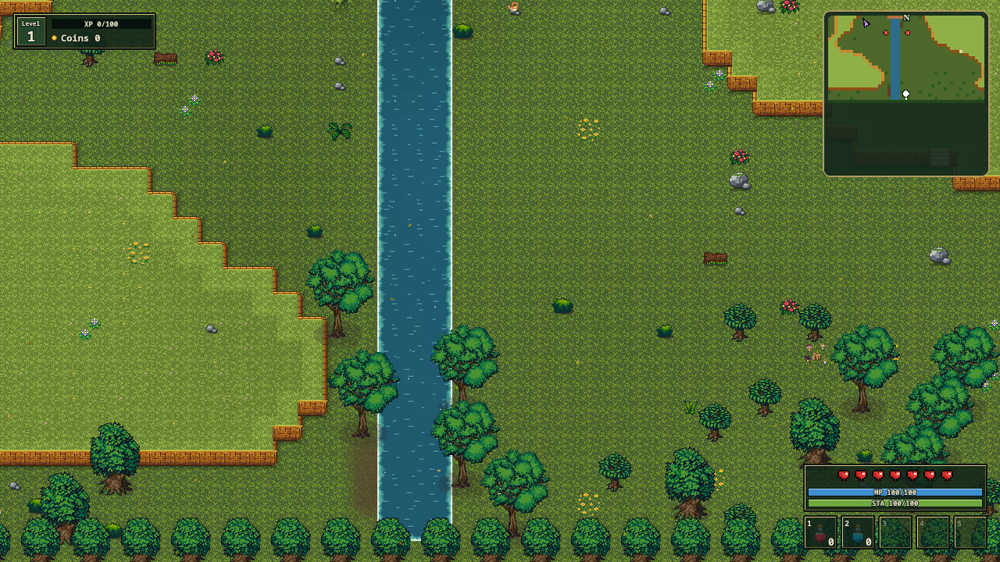       | 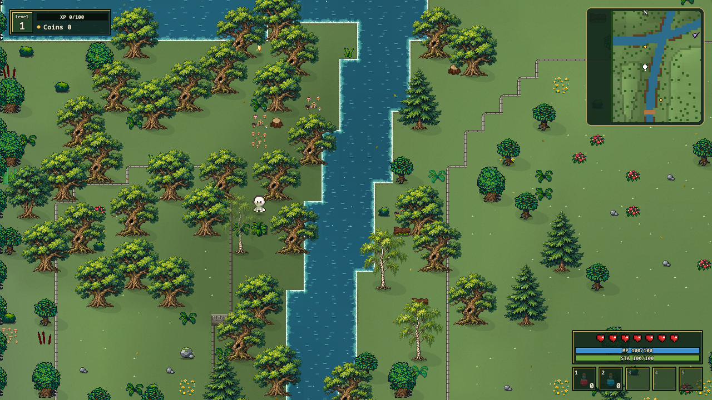            |
| 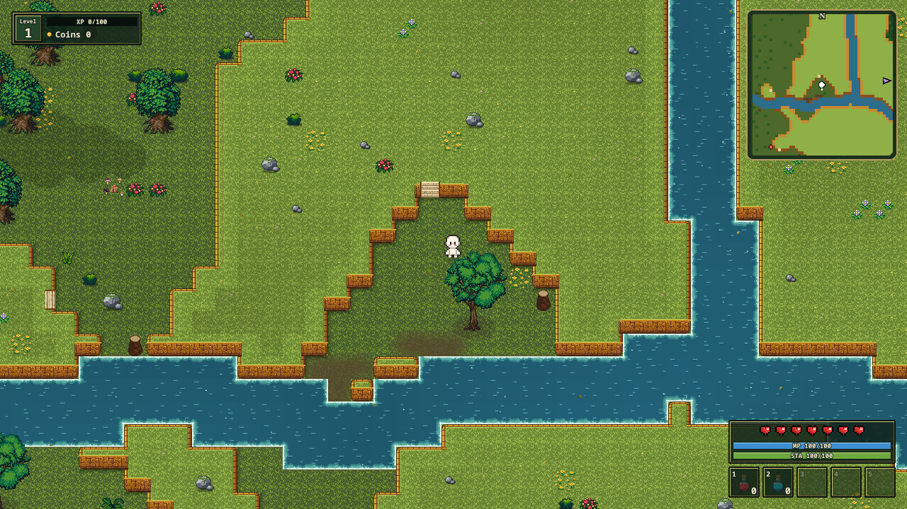          | 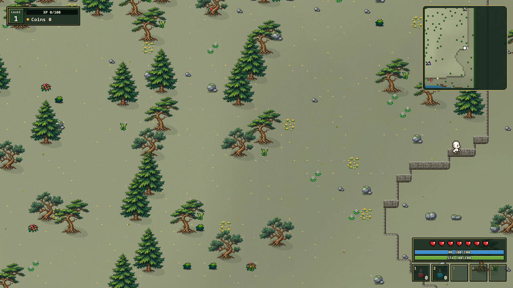 |
| 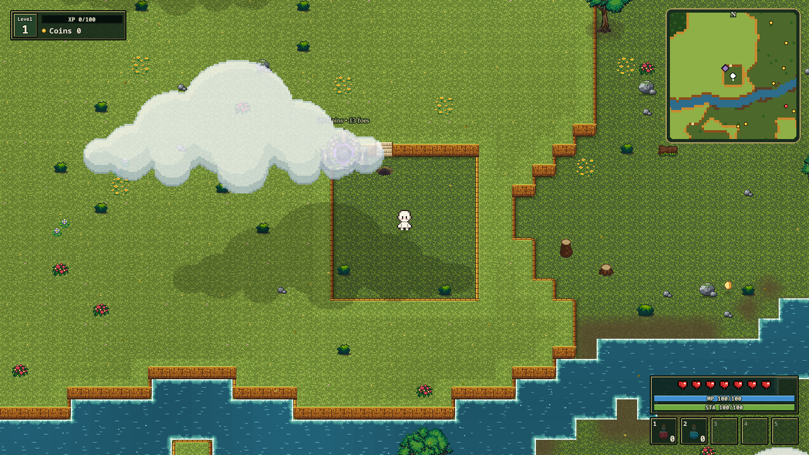 | 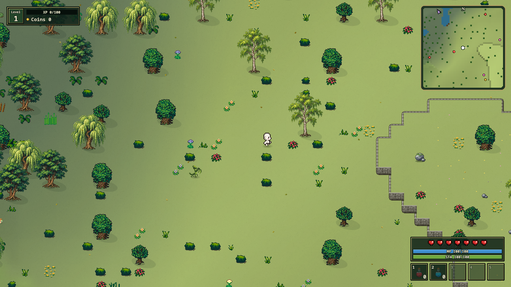                 |

| Rocky highlands                                                      | Wetlands                                                     |
| -------------------------------------------------------------------- | ------------------------------------------------------------ |
| 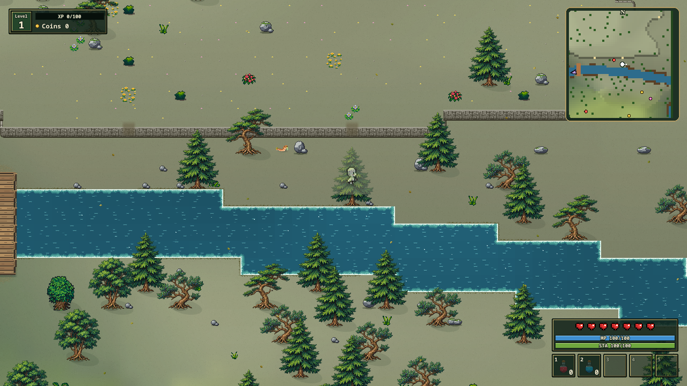 | 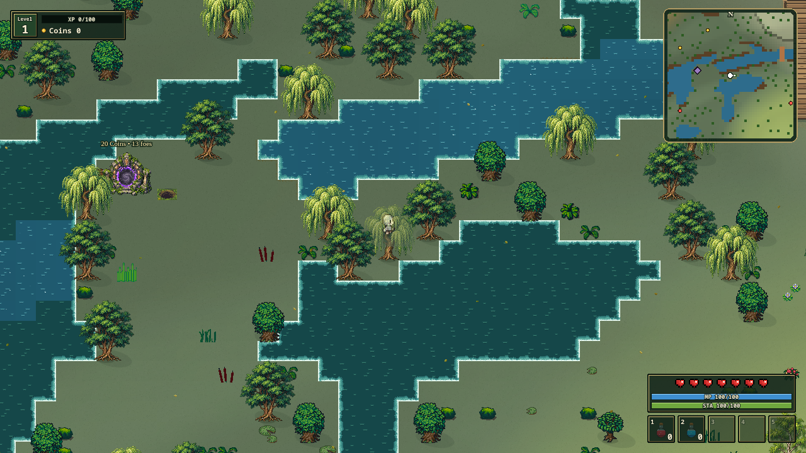 |

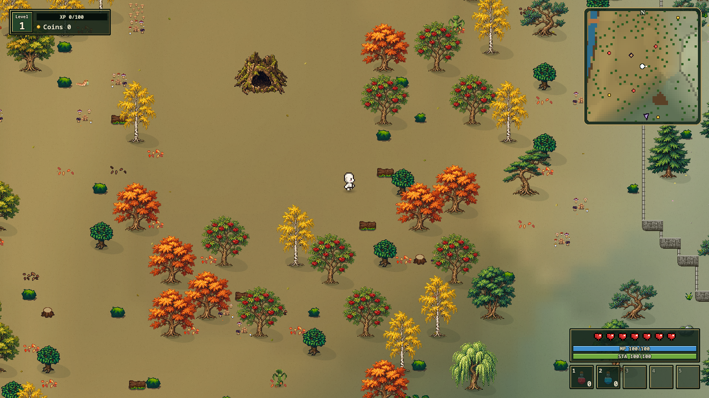

Additional actual-game views: [sparse woodland](images/environment/sparse-woodland.png),
[dense woodland](images/environment/dense-forest.png), [old growth](images/environment/old-growth.png),
[clearing](images/environment/forest-clearing.png), [river crossing](images/environment/river-crossing.png),
[biome transition](images/environment/biome-transition.png) and
[render-chunk boundary](images/environment/chunk-boundary.png).
See [testing](testing.md#biome-landscape-checks) for capture and walking-route checks,
and [performance](performance.md#five-biome-environment-2026-11-03) for measured costs.

## Streamed worlds

New games use independently addressable 32×32 data chunks, without a world width
or height. The finite generator remains version 13 and keeps whole-map saves.
Generator and biome versions are pinned in each streamed descriptor; adding a
new algorithm never silently changes terrain in an existing streamed world.

`ChunkSource` owns bounded baseline residency. `ForestGenerator` samples signed,
coordinate-hashed coherent fields rather than consuming one map-wide random
sequence. Water bands, hills and woodland density continue across chunk borders.
Bridges have deterministic spatial candidates and priorities; ownership belongs
to the anchor chunk while neighboring queries include their full reservations.
Trees obey spacing, canopy/stair and bridge protections. Hilltop rocks use the
existing physical footprint and continuous swept-bypass validation.

The fixed starting plan reserves a clearing, twenty required coins, the existing
difficulty-dependent enemy count, a nest and a progression portal. Exploring
farther adds optional enemies, chests and ghost groves. Portal completion uses a
persistent objective ledger, including objectives outside the active area.
Taking the portal still advances to a new seeded world and carries character
progression, inventory and buffs; it does not add return travel to earlier levels.

### Local gameplay adapter

The authoritative world is the chunk source plus saved changes. Existing swept
collision, surfaces, navigation and rendering consume a bounded `WorldData`
window. Its `meta.width/height` describe that local view, not the world's extent.
`world.window.originX/originY` convert local actor/tile coordinates to global
coordinates. Origins are chunk-aligned; floor division and positive local
remainders handle negative coordinates. The usual window is 192×192 tiles and
can grow for viewport/zoom preparation. Baselines remain independently generated
chunks; this window is neither a repeated map nor a pre-generated complete world.

Generation runs in a module worker with transferred tile buffers. The fallback
yields between rows. Preparation includes a surrounding chunk halo; inactive
baseline chunks have a five-second retention period and a hard residency limit
of 128 or the larger mandatory viewport set. Pending preparation adds a bounded
working set. Actor records, colliders, AI clearance and object catalogs remain
local. Before eviction, changes and the global player checkpoint are committed
together. Actors moving between chunks have one owner; managed encounter actors
remain owned by their site. Unloaded actors suspend rather than receiving new
health or rewards when reactivated.

Ordinary window shifts prepare an owned candidate while the active window keeps
simulating. Terrain rows in the overlap are copied from the active view; only
entering chunks need baseline/delta assembly. Surface eligibility and prop
collider indexes are built cooperatively with a 2 ms task target. This target is
cooperative, not a hard deadline. Surface hashes still use the established local
coordinates, so the target surface index is rebuilt rather than reused with
different coordinates.

Publication is one synchronous operation between simulation calls. It captures
the latest edits, actors and discovery, copies live overlapping moisture without
byte quantization, rebases retained actors, and installs the prepared indexes.
Edits or a viewport/teleport change during preparation invalidate the candidate.
The serialized checkpoint may finish afterward; pruning waits for durability.
Only one automatic checkpoint is pending. A persistence error retains changes
and prevents another shift; the existing edge guard still stops unsafe travel.
An explicit successful save can recover that condition. Explicit distant jumps pause gameplay while candidate terrain and assets prepare.
The active origin changes only after readiness; a failed asset load preserves the
old scene and coordinates so the jump can be retried.

Rendering rebases coordinates before they reach Pixi. Terrain textures retain
their global identity across rebases; actor animation, effects, sky, soil grain,
water and depth ordering use the same translation. Texture chunks remain 16×16,
independent of the data-chunk size. Camera bounds belong only to finite worlds.
Minimaps use a local image and persisted discovery masks; preparation alone does
not reveal terrain. M cycles radar, a larger regional view, and hidden.

Supported global tile coordinates are bounded by ±2,147,483,647. Runtime travel
reserves a 1,024-tile margin for feature and viewport queries. This is practical
unbounded exploration, not mathematical infinity. Numeric diagnostic zoom in
streamed worlds is at least 0.5; normal automatic zoom remains pixel-aligned.

### Biome and region identity

`BiomeGeography` samples warped temperature, moisture, relief, seasonal and river
fields at global coordinates. Macro scales of 380–620 tiles form broad regions;
48-tile groves and 24-tile clearings supply local vegetation variation.
River contours lower surrounding relief and increase moisture. These are coherent
fields, not a drainage simulation. Climate score differences determine transition
weights; ground colors, canopy density and neighboring species blend together.

Generator 15 separates local high ground from climate elevation. The former
global relief cutoff excluded hills from four starting biomes. Each biome now has
its own `landform` scale, threshold and ridge weight in `Biomes.ts`: forest and
autumn form wooded rises, meadow has broad grassy hills, highlands have more
frequent rocky shelves, and wetlands have fewer raised banks above the pools.
Fixed-frequency noise fields (19–28 tiles), ridge fields and two-scale domain
warping produce the shapes. Biome weights blend the sampled fields, not the
coordinate divisors, preserving smooth transitions even at very large coordinates.
River valleys and a small tapered spawn hollow suppress high ground.

Seed-42 tuning samples use a 128×128 area around each climate anchor. The
percentage includes all cells, including water; slopes are counted within that
same area. These samples describe this seed, not a quota applied to every region.

| Region    | Raised cells, v14 → v15 | Slopes, v14 → v15 |
| --------- | ----------------------: | ----------------: |
| Forest    |            0.0% → 46.1% |            0 → 50 |
| Meadow    |            0.0% → 22.4% |            0 → 27 |
| Highlands |           75.6% → 48.9% |            3 → 56 |
| Wetlands  |            0.0% → 17.2% |            0 → 31 |
| Autumn    |            0.0% → 35.6% |            0 → 26 |

Slope sites require a three-tile-wide shoulder and two clear cells on each side
of the elevation change. A six-tile local priority rule spaces entrances on north,
east, south and west faces independently of chunk ownership. Each opening uses
the existing 28-pixel walking corridor. Trees and props avoid the approach; hilltop
trees require surrounding plateau cells. Ordinary swept player/enemy collision
uses the same cliff masks and slope openings as the art. Generator 15 retains the original
two-level terrain model: walking up slopes reaches real raised surfaces, walking
into cliff faces is blocked, and the established jump rule remains available.

Generator 16 preserves those base hills and adds nested terraces at heights 2 and 3.
`TerracePlanner` owns each candidate in a global 64×64 cell. A distance field keeps
its irregular, warped crown at least four cells inside the parent surface, including
at chunk boundaries. Only the connected crown containing its chosen center survives.
A three-wide, two-deep dry stair approach must connect it to the parent before the
crown is accepted; separated additional entrances improve circulation. Meadow and
wetlands stop at tier 2; forest/autumn can reach tier 3, and highlands favour it.
Wetland upper terraces are deliberately sparse. These are terraces in the existing
top-down projection, not free-form 3D slopes or overhangs.

Generated chunks and local windows carry an optional byte-per-cell `elevations`
array. `elevationAt` and height-relative `elevationMask` drive cliff art, collision,
landscape inspection, same-level plateau components, hilltop placement and loot
reachability. Material edits retain procedural height. Jump timing is unchanged;
landings more than one tier from takeoff use the existing safe-position recovery.
Upper stair approaches exclude props. Workers transfer height buffers with tiles;
only seed/version and existing sparse changes are saved. The 64-plan terrace cache
uses at most 256 KiB of height arrays per generator, independent of distance travelled.
Versions 13–15 keep their original generation; versions 15 and 16 share the improved
biome-specific cliff and stone-step artwork.

A forest climate anchor at the origin and four seed-rotated anchors 440–599 tiles
away guarantee nearby examples of every biome. Their influence feathers into the
same climate fields over 210 tiles. Beyond these starting regions, the same fields
continue indefinitely; there are no five separate maps or repeated map tiles.

`Biomes.ts` owns current asset palettes and densities. `infinite/biomes.ts` retains
the frozen forest v1 tuning and registers all five v2 identities. New trees have
stable `assetKey` and variant metadata: forest uses the four original LPC forms;
meadow uses birch/rowan, highlands pine/juniper/fir, wetlands willow/alder, autumn
maple/golden birch/beech. Interior tree sets are disjoint. Transition bands may
select the neighboring biome's trees deliberately. Logs, bridges and strong rock
art stay shared. Placement and collision use global identity and trunk footprints;
canopies are overhead, never invisible walls.

The first preparation of each 256×256 region commits its generator version and
centre-sampled biome identity. This record pins the generation policy; it does not
paint an entire square region one biome. Per-cell classification continues across
region and chunk boundaries. Unsupported or conflicting versions fail before
publishing terrain. Generators 13, 14 and 15 retain their original fields and objects.

### Biome Walk

Developer → Biomes selects a safe starting location in a persistent seed-42 world.
`BiomeLanding` searches the actual generated/edited window, excludes water starts,
and validates the player footprint plus at least 80 reachable nearby positions
with the normal swept movement rules. New landings prefer a safe approach
to a visible nested terrace or slope; wetlands also favour nearby water. Terrain and required assets are prepared before play.
Changing biome keeps the same session, seed and edits. Returning to the original
spawn uses normal safe-position recovery. Walking across regions never invokes a
biome switch or loading screen.

Exploration omits enemies, encounters, required pickups and the progression portal;
stamina and mana remain full. Adventure retains the finite starting objective
ledger and portal progression described above. Exploration uses isolated save
slots; see [save format](save-format.md#streamed-worlds-schema-3).
Opening Biome Walk from Play chooses the current terrain generation. An older
exploration is retained under **Resume previous landscape**; Change Biome inside
that older session continues using its original world.

### Current streamed gallery

These are actual generator-16, seed-42 Biome Walk captures at 1280×720 using real runtime assets. Each landing shows accessible high ground. Menu previews are crops of these captures, reproduced by
`node scripts/prepare-environment-assets.mjs`.

| Forest                                                                            | Meadow                                                                            | Rocky Highlands                                                                            |
| --------------------------------------------------------------------------------- | --------------------------------------------------------------------------------- | ------------------------------------------------------------------------------------------ |
| [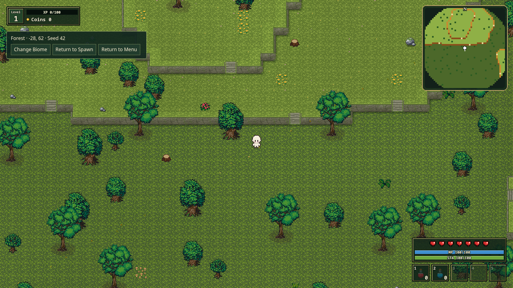](images/infinite-biomes/forest.png) | [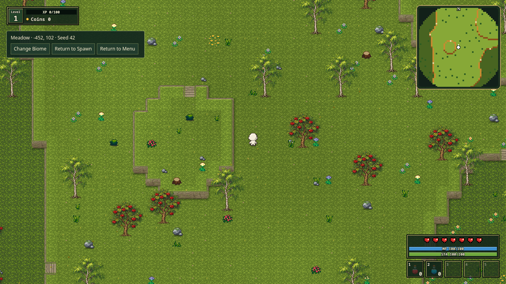](images/infinite-biomes/meadow.png) | [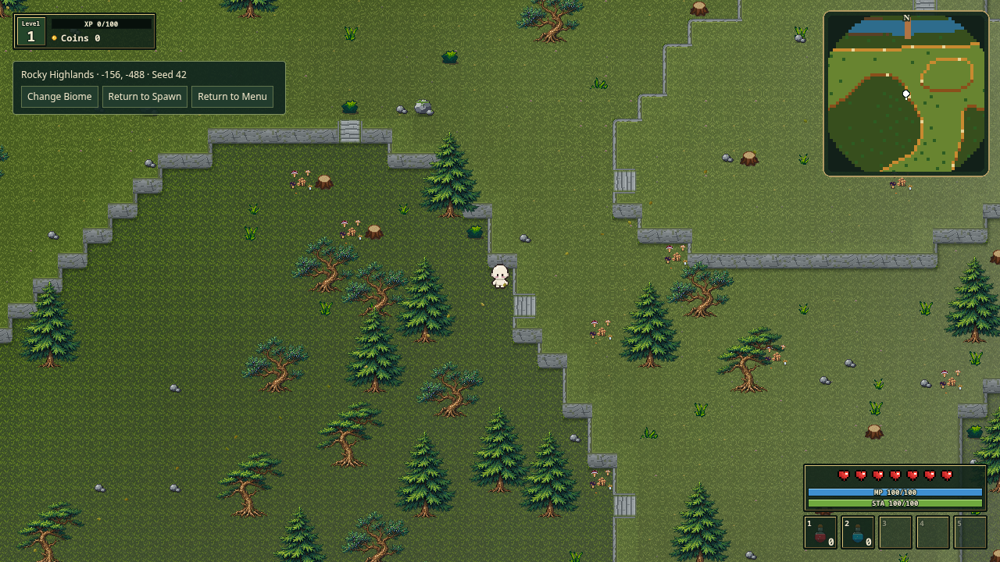](images/infinite-biomes/highlands.png) |

| Wetlands                                                                                | Autumn Woodland                                                                   |
| --------------------------------------------------------------------------------------- | --------------------------------------------------------------------------------- |
| [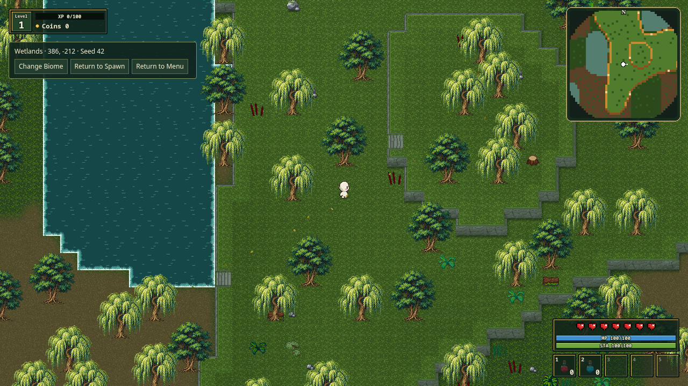](images/infinite-biomes/wetlands.png) | [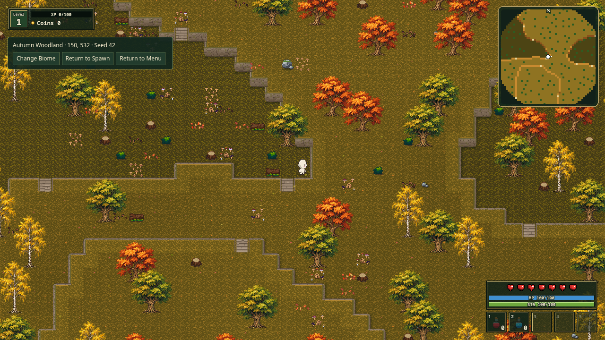](images/infinite-biomes/autumn.png) |

The forest entry comparison uses each version's safe landing in the same seed.
The camera positions differ because the new landing prefers a visible slope.

| Previous forest entry (v14)                                                                                          | Forest with nested high ground (v16)                                                     |
| -------------------------------------------------------------------------------------------------------------------- | ---------------------------------------------------------------------------------------- |
| [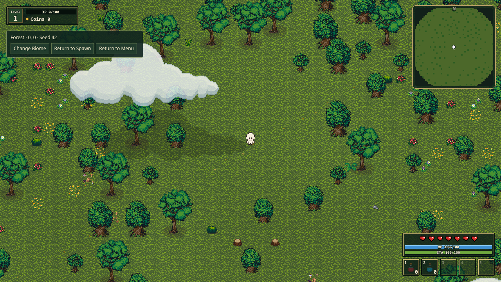](images/infinite-biomes/forest-before-hills.png) |  |

The transition pair below follows ordinary keyboard movement from forest into
meadow in the same session. The third capture crosses the former x=150 boundary
on foot; the minimap shows the local streamed region.

| Before transition                                                                                            | After transition                                                                                           | Beyond x=150                                                                                                       |
| ------------------------------------------------------------------------------------------------------------ | ---------------------------------------------------------------------------------------------------------- | ------------------------------------------------------------------------------------------------------------------ |
| [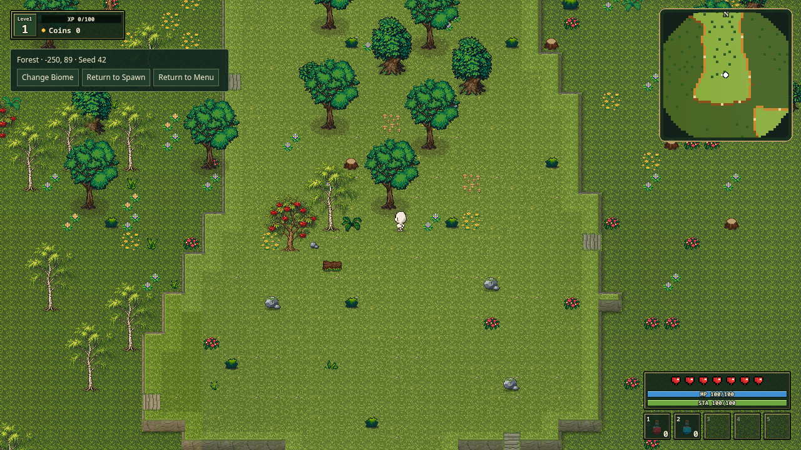](images/infinite-biomes/transition-before.png) | [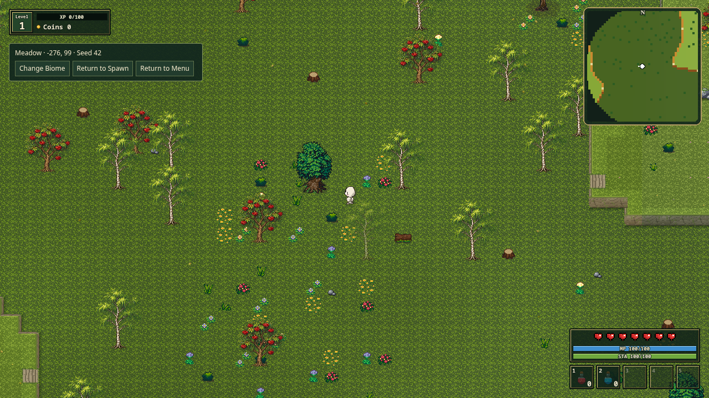](images/infinite-biomes/transition-after.png) | [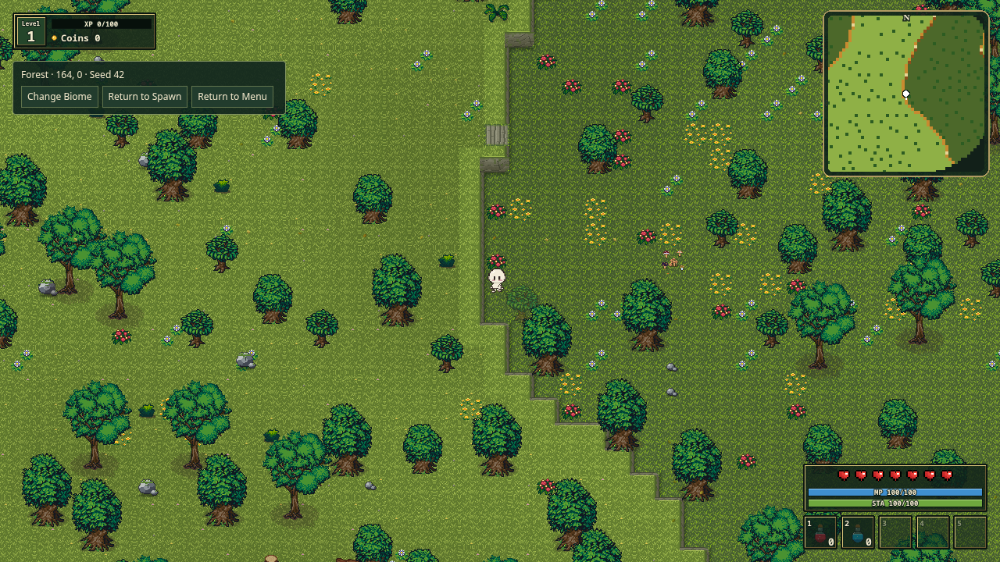](images/infinite-biomes/past-150-on-foot.png) |

`WorldEdits` supplies typed tile, removal, placement and event records for future
systems. Existing cutting, loot, chest and encounter changes already persist.
There are no new player building or terrain-editing controls.

The nested highland example shows a third raised tier, reached by normal keyboard
movement and revisited after chunk eviction:

[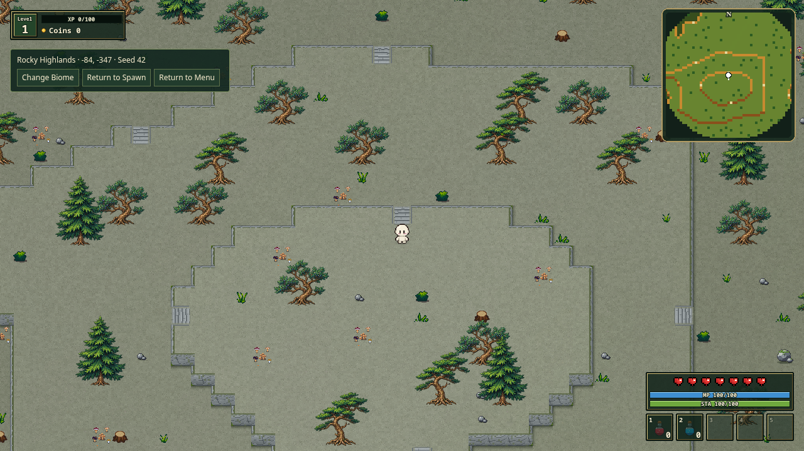](images/infinite-biomes/highlands-third-tier.png)

| Previous binary hills (v15)                                                                                               | Nested terraces and stone steps (v16)                                                   |
| ------------------------------------------------------------------------------------------------------------------------- | --------------------------------------------------------------------------------------- |
| [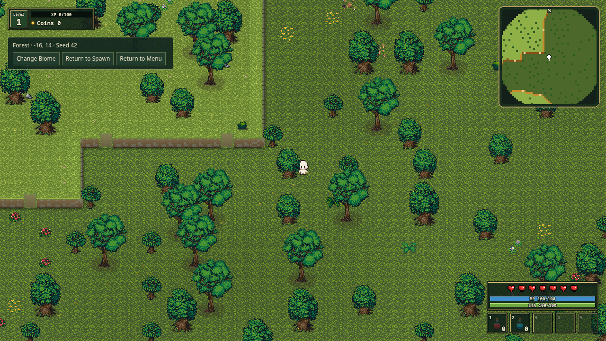](images/infinite-biomes/forest-before-terraces.png) |  |
